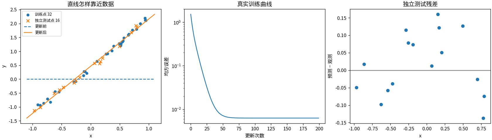
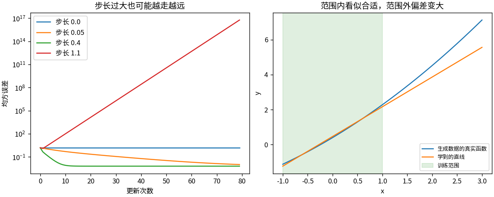

# T1 让一条直线学会调参数

一条直线只有两个参数，却已经包含一次训练的基本过程：给出预测，计算误差，求出梯度，再更新参数。本篇用这个最小模型解释学习率和损失，也观察它为什么会在训练范围之外失准。

只需会代入一元函数；导数在这里表示「参数稍微变化时，损失向哪个方向变化」。实现见 [t01_linear.py](../toys/t01_linear.py)，测试见 [test_t01_linear.py](../tests/test_t01_linear.py)。文中数字和图片对应随包保存的种子 42 记录，环境与复现说明见 [README](../README.md)。

## 梯度是一张局部路标

模型写成 `预测值 = w*x + b`。`w` 决定斜率，`b` 决定截距。训练要找到一组参数，使预测接近已知观测；参数不会因为读入了数据就自行变化，需要损失函数和更新规则。

先只看一个点：输入 x=2，目标 y=5，初始 w=1、b=0。用平方误差衡量预测偏差：

| 计算 | 代入结果 |
|---|---|
| 预测 `w*x+b` | 2 |
| 误差 `预测−目标` | −3 |
| 损失 `L=误差²` | 9 |
| 权重梯度 `dL/dw=2*误差*x` | −12 |
| 偏置梯度 `dL/db=2*误差` | −6 |

梯度描述损失上升的局部方向，因此更新时要减去梯度。学习率取 0.1，用同一次前向计算得到的两个梯度一起更新：

```text
w_new = 1 − 0.1×(−12) = 2.2
b_new = 0 − 0.1×(−6)  = 0.6
预测   = 2.2×2 + 0.6   = 5
```

这一步恰好命中目标，是这个单点与学习率的数值巧合。它不意味着所有训练都能一步完成，也不能仅凭一个点确定唯一一条直线。

多个点通常不能同时命中。对 N 个样本，代码使用均方误差（MSE）：

```text
error_i = w*x_i + b − y_i
L       = mean(error_i²)
dw      = mean(2*error_i*x_i)
db      = mean(2*error_i)
```

`mean` 表示对所有样本取平均。每个点都会对梯度作出贡献：某个点希望直线上移，另一个点可能希望它下移，最后由平均梯度决定这一步怎样走。`loss_and_grads` 计算这些量，`train` 重复执行 `参数 -= 学习率 * 梯度`，没有调用自动求导。

## 把一笔计算变成连续更新

在项目根目录运行 `python -m toys.t01_linear`，或 `python run_all.py --only t01`。默认命令会覆盖对应的输出文件；如需保留随包结果，可运行：

```bash
python run_all.py --only t01 --seed 42 --output outputs_local
```

`make_data` 用种子 42 生成 32 个训练点，用种子 1042 生成独立的 16 个测试点。两组 x 都从 [−1,1] 内采样，生成函数为 `1.7*x+0.4+0.18*x*x`，观测另加标准差 0.08 的噪声。模型仍只允许画直线，所以数据中的二次项无法由它精确表达。

训练从 w=0、b=0 开始，学习率为 0.1，更新 200 次。测试点只用于评估，不进入更新公式。

| 指标 | 随包实测值 |
|---|---:|
| 更新后的 w / b | 1.69727 / 0.46720 |
| 初始训练 MSE | 1.52340 |
| 最终训练 MSE | 0.006264 |
| 独立测试 MSE | 0.007891 |

完整结果保存在 [metrics.json](../outputs/t01/metrics.json)。训练损失回答「模型与用来调参数的数据有多接近」，测试损失回答「换成同一生成条件下的新观测后，误差有多大」。两者都只针对这里的数据分布。



左图比较更新前后的直线；中图记录各次更新前的训练损失；右图画测试点的 `预测−观测`。右图中的残差有正有负，MSE 则把它们平方后平均，因此正负误差不会互相抵消。训练后仍有残差，既与噪声有关，也与直线的表达限制有关。



第二张图左侧把学习率设为 0、0.05、0.4、1.1，分别观察 80 次更新。学习率为 0 时参数不动；步长过大时，一次更新可能跨过合适区域，使损失增大。梯度只提供当前位置附近的方向，不承诺沿这个方向走任意远都更好。

脚本还把生成噪声的标准差依次改为 0.02、0.08、0.25，重新生成训练和测试观测，分别训练后测得测试 MSE 为 0.003330、0.007891、0.048248。这改变了两组数据的生成条件，不能解释成仅改变训练噪声、在固定测试集上比较的因果实验。

第二张图右侧把 x 扩展到 3。此时直线预测为 5.559，生成函数的无噪声值为 7.12。训练数据都在 [−1,1]，范围内较低的误差没有约束模型在范围外的表现；二次项带来的偏差在那里变得更明显。

## 哪些环节已经核对

训练损失下降，不能单独证明梯度实现正确。测试还用中心有限差分作独立核对：把某个参数分别增加、减少很小的 ε，估计导数为 `(L(θ+ε)−L(θ−ε))/(2ε)`，再与公式算出的梯度比较。

- 单点手算中的损失、两个梯度和更新结果一致。
- float64 中心有限差分检查两个参数，随包记录的最大绝对误差约为 1.21×10⁻¹¹。
- 学习率为 0 时参数严格不变；相同种子生成相同数据；训练与测试输入无重复。
- 参数保存到 `parameters.npz` 后重新读取，预测逐元素相同。

复核命令为 `python -m unittest discover -s tests -p 'test_t01_linear.py' -v`。有限差分检查的是选定位置附近的导数；保存与重载检查的是文件里的参数是否得到保留，都不能代替测试集评估。

读代码可按 `predict → loss_and_grads → train → demo` 的顺序。下一篇沿用「预测、损失、梯度、更新」这条流程，把输出改成两个类别的概率。

[返回目录](../README.md) · [下一篇：逻辑回归](T02_逻辑回归.md)
