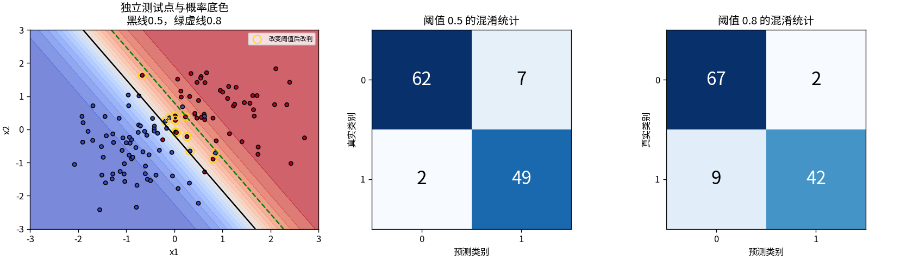
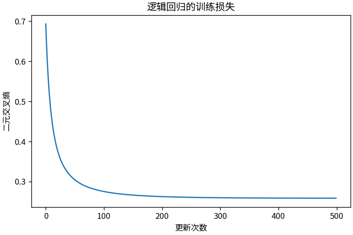

# T2 给两种小点分组的迷你分类器

上一篇用直线预测连续数值。这一篇仍从线性分数出发，但要回答一个分类问题：一个二维点属于 0 类还是 1 类？逻辑回归先给出属于 1 类的概率，再用阈值作决定。概率怎么学、决定怎么作，需要分开看。

建议先读 [T1](T01_线性回归.md) 的损失与梯度。实现见 [t02_logistic.py](../toys/t02_logistic.py)，测试见 [test_t02_logistic.py](../tests/test_t02_logistic.py)。以下实测值对应随包种子 42 的记录，运行环境见 [README](../README.md)。

## 一条线怎样变成概率

先固定一个用于手算的线性分数 `z=x1+x2−1`，再用 sigmoid 函数把它转成概率：`p=1/(1+exp(−z))`。这里 p 表示模型给 1 类的概率，0 类的概率为 `1−p`。

| 点 | 分数 z | p（约） | 阈值为 0.5 时的预测 |
|---|---:|---:|---:|
| (0,0) | −1 | 0.269 | 0 |
| (1,1) | 1 | 0.731 | 1 |

阈值为 0.5 时，代码把 `p>=0.5` 判为 1 类。由于 sigmoid(0)=0.5，分界线就是 `x1+x2=1`。若把阈值提高到 0.8，上表第二个点也会改判为 0；两个点的概率都没有改变。

这解释了图中连续的概率底色与最终类别的区别：训练改变权重和偏置，进而改变概率；调阈值只改变如何使用已有概率。在同一批概率上提高阈值，被判为正类的点只会减少或保持不变。

## 让分界线从数据中移动

实际训练不沿用手算权重，而是从两个权重和一个偏置全为零开始。输入矩阵 x 的形状为 `(N,2)`，标签 y 的形状为 `(N,)`，分数为 `z=x@w+b`。符号 `@` 表示矩阵乘法。

标签只能是 0 或 1。二元交叉熵把正确类别的低概率转成较大的惩罚：单点损失为 `−y*log(p)−(1−y)*log(1−p)`，整批损失取平均。代码使用等价的稳定写法 `mean(logaddexp(0,z)−y*z)`，避免先计算极接近 0 或 1 的概率，再对 0 取对数。对数使用自然对数。

反向计算可写成三步：

```text
dz = (sigmoid(z) − y) / N
dw = x.T @ dz
db = sum(dz)
```

例如某个标签是 1，而模型给出的 p 偏低，该点的 `p−y` 为负；优化会尝试提高它的分数。每个样本都参与这三个参数的更新，因此实际移动还取决于其他点。这里训练的是概率损失，阈值不参与梯度计算。

在项目根目录运行 `python -m toys.t02_logistic`。若需保留随包图表，改用：

```bash
python run_all.py --only t02 --seed 42 --output outputs_local
```

160 个训练点和 120 个独立测试点来自两团有重叠的高斯分布，种子分别为 42 和 1042。默认噪声尺度为 0.8，生成时正类概率设为 0.5；有限样本中两类数量不必恰好相等。训练使用学习率 0.15，更新 500 次，随包测试交叉熵为 0.19842，准确率为 92.5%。



左图的黑实线对应阈值 0.5，绿虚线对应 0.8；金色圈标出阈值变化后改判的点。右侧两张混淆矩阵都以行为真实类别、列为预测类别：对角线是正确判定，另外两格分别是误报和漏报。

| 阈值 | 69 个负类中的误报 | 51 个正类中的漏报 |
|---|---:|---:|
| 0.5 | 7 | 2 |
| 0.8 | 2 | 9 |

共 12 个点从正类改判为负类：其中 5 个消除了误报，另外 7 个增加了漏报。提高阈值让模型更少报正类，是否合适取决于两种错误的代价；这里没有据测试集搜索最优阈值，0.5 与 0.8 是预先指定的演示值。



曲线记录训练交叉熵，而非准确率。准确率只关心概率有没有跨过阈值；交叉熵还会区分正确类别得到的概率高低，所以两者不必同步变化。

脚本还在三个数据条件下分别重新训练并评估：较少重叠时测试准确率为 100%，明显重叠时为 80.83%，正类较少时为 93.33%。这些是不同合成条件下的有限样本成绩，不能仅凭准确率高低判断哪个条件更容易。尤其在正类较少时，总准确率可能掩盖漏报，需要同时看混淆矩阵。

## 这条线能承诺什么

sigmoid 的输出可用作概率模型，但本实验没有做概率校准检验。模型给出 0.93，并不等于已经验证现实中这类预测有 93% 的可靠性。

模型的分数仍是输入的线性函数，因此固定阈值对应一条直线。sigmoid 改变了输出尺度，没有让分界线自动弯曲；下一篇的 XOR 就需要更强的表达能力。逻辑回归优化可微的概率损失，与按误分类规则更新的感知器也不是同一种训练算法。

已有检查包括：零分数输出 0.5；±1000 的极端分数仍得到有限损失与梯度；三个参数的中心有限差分最大绝对误差约为 3.95×10⁻¹²；训练测试点无重复；保存再读取的预测完全一致。

复核：`python -m unittest discover -s tests -p 'test_t02_logistic.py' -v`。完整数字见 [metrics.json](../outputs/t02/metrics.json)，权重在同目录的 `parameters.npz`。阅读实现时，`loss_and_grads` 对应训练目标，`confusion` 对应阈值之后的评估；这两个入口也保留了训练与决策的区别。

[上一篇：线性回归](T01_线性回归.md) · [返回目录](../README.md) · [下一篇：反向传播](T03_反向传播.md)
