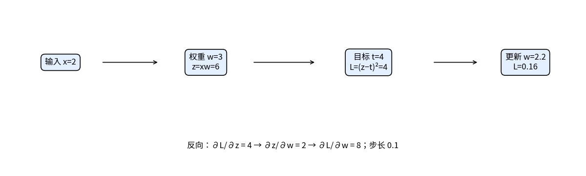
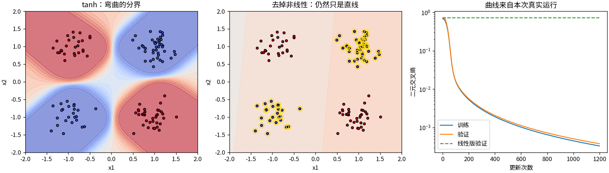
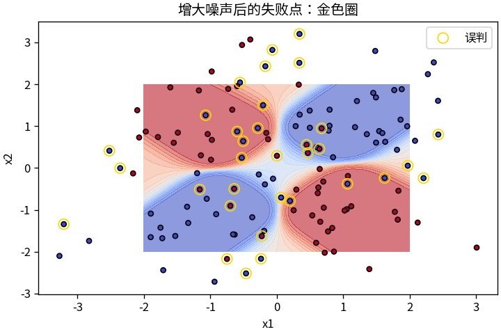

# T3 用一个小网络讲清反向传播

逻辑回归的梯度只需穿过一个线性分数。加上隐藏层以后，参数离损失更远，但仍可以沿计算过程逐步求导。本篇用 17 个参数的网络拟合 XOR，说明反向传播怎样复用中间结果，以及为什么多一层还需要非线性。

建议先读 [T2](T02_逻辑回归.md) 的二元交叉熵。实现见 [t03_mlp.py](../toys/t03_mlp.py)，测试见 [test_t03_mlp.py](../tests/test_t03_mlp.py)。本文图表与实测数字对应随包种子 42 的记录，环境见 [README](../README.md)。

## 沿着计算链倒着算

先看一条只有乘法的链：输入 x=2，权重 w=3，输出 z=xw=6，目标 t=4，平方损失 `L=(z−t)²=4`。损失经由 z 依赖 w，链式法则把这一关系拆成：

```text
dL/dz = 2×(6−4) = 4
dz/dw = 2
dL/dw = (dL/dz)×(dz/dw) = 8
```

学习率为 0.1 时，w 更新为 `3−0.1×8=2.2`，输出变成 4.4，损失降到 0.16。这个手算采用平方损失；后面的 XOR 分类训练使用二元交叉熵。两种损失都能沿同一条计算链反传，只是起点导数不同。



反向传播把「沿一条路径乘导数，多条路径汇合时加贡献」组织成一次逆序计算。前向先保存中间量，反向再使用它们；求得梯度以后，优化器才负责更新参数。这三个步骤各有职责。

## 17个参数，分开四个角

XOR 的规则是：两个输入符号不同记作 1，相同记作 0。四个角 `(-1,-1)、(-1,1)、(1,-1)、(1,1)` 的标签依次为 `0、1、1、0`，两类位于相对的角，一条直线无法将它们全部分开。

本篇使用输入 2 维、隐藏层 4 维、输出 1 维的多层感知机（MLP）。对 N 个样本，计算与形状如下：

| 量 | 计算或作用 | 形状 |
|---|---|---|
| x | 输入坐标 | `(N,2)` |
| W1 / b1 | 第一层权重 / 偏置 | `(2,4)` / `(4,)` |
| a | `x@W1+b1` | `(N,4)` |
| h | `tanh(a)` | `(N,4)` |
| W2 / b2 | 输出层权重 / 偏置 | `(4,1)` / `(1,)` |
| z | `h@W2+b2`，随后展平 | `(N,)` |

参数总数为 `2×4+4+4×1+1=17`。tanh 把隐藏值压到 −1 与 1 之间，使隐藏层能够表示非线性变换。输出 z 仍是未归一化分数，sigmoid(z) 才是 1 类概率。

`forward` 保存 x 和 h。`loss_and_grads` 从批次平均二元交叉熵开始，把 z 的梯度整理成 `(N,1)`，按以下顺序反传：

```text
dz  = ((sigmoid(z)−y)/N)[:, None]
dW2 = h.T @ dz             db2 = sum_batch(dz)
dh  = dz @ W2.T
da  = dh * (1−h*h)
dW1 = x.T @ da             db1 = sum_batch(da)
```

这里 `@` 是矩阵乘法，`*` 是逐元素乘法。`1−h*h` 来自 tanh 的导数；偏置被批次中的所有样本共享，所以它的梯度沿批次求和。每个梯度的形状都应与对应参数一致。

去掉 tanh 后，隐藏层就只是 a。此时整个分数可以展开为 `x@(W1@W2)+(b1@W2+b2)`，仍然只有一个线性变换。保留层数和参数数量，没有增加可表示的分界线种类。这是脚本中线性消融的依据。

在项目根目录运行 `python -m toys.t03_mlp`。默认种子为 42，隐藏权重初始标准差为 0.35，输出权重为 0.25；Adam 学习率为 0.03，训练 1,200 步。Adam 根据梯度的历史统计调整更新，不负责计算导数。保留随包结果可运行：

```bash
python run_all.py --only t03 --seed 42 --output outputs_local
```



前两幅图比较有无 tanh 时的概率分布，金色圈标出误判；第三幅图比较训练与验证损失。代码在记录点保存更新前的训练损失和更新后的验证损失，两条曲线相差一次更新，适合观察趋势，不应据同一点的微小差值判断泛化差距。

先只训练四个精确 XOR 点，按上文顺序得到概率约为 0.000050、0.99844、0.99983、0.00161。它证明网络能拟合这四个点，但还没有检验新观测。

另一组实验在底层角点上加入标准差 0.22 的独立噪声，分别生成 128 个训练点、128 个验证点和 128 个测试点，种子为 42、1042、2042，观测向量没有重复。参数只由训练集更新，验证集用于记录曲线，最终模型再在测试集评估。

| 指标 | 随包实测值 |
|---|---:|
| 最终训练 / 验证 / 测试损失 | 0.000332 / 0.000380 / 0.000567 |
| 含 tanh 的测试准确率 | 100%（128/128） |
| 去掉 tanh 的测试准确率 | 47.66% |

这些值来自固定训练预算后的参数。精确四点实验与含噪声实验分别训练，不能把前者的拟合结果当作后者的泛化证据。

## 让失败也露出来



把新测试点的噪声标准差增至 0.9，已训练的非线性模型准确率降到 74.22%。图中金色圈标出误判。标签仍由加噪声前的角点决定；噪声可能将点推入另一个类别常见的区域，因此坐标本身也可能不足以恢复原标签。

训练过程同样可能失败。同一种子、结构和学习率，仅将两组初始权重的标准差翻倍，训练损失约为 0.31869，测试准确率为 66.41%。这说明本次结果对初始化敏感；仅凭这一次失败，还不能断言唯一原因。

默认较小初始化是在开发时依据训练损失排查确定的。这里保留了选择依据和失败对照，但没有做多种子统计，也不是预注册的性能基准。

## 检查怎样落到每个参数

中心有限差分逐个检查全部 17 个参数，float64 下随包记录的最大绝对误差约为 8.54×10⁻¹²。非线性与线性消融两条路径都接受检查；另核对梯度形状、有限值、数据分离、相同种子复现，以及保存读取后的预测一致性。

「损失能下降」与「梯度符合当前损失的导数」是两项检查，不能互相替代。有限差分仍只检验选定输入和参数附近的局部行为，也不保证训练一定找到好解。

复核：`python -m unittest discover -s tests -p 'test_t03_mlp.py' -v`。完整指标、失败点坐标和概率见 [metrics.json](../outputs/t03/metrics.json)。阅读实现可依次看 `forward` 的缓存、`loss_and_grads` 的逆序计算，再看 `train` 中的 Adam 更新。

这里的网络单元是数学结构，不代表人脑神经元的完整工作方式。下一篇会把同一套反向传播规则用于卷积核：一个参数在多个位置被使用，反向时就要累加所有位置的贡献。

[上一篇：逻辑回归](T02_逻辑回归.md) · [返回目录](../README.md) · [下一篇：CNN](T04_CNN.md)
