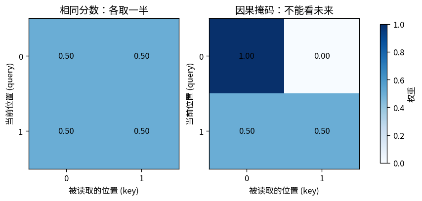

# T07：把自注意力拆成可手算、可求导的四步

RNN 把前缀信息递推到一个状态中。自注意力提供另一种读取方式：当前位置直接给可见位置分配权重，再取这些位置的值的加权和。本篇先把读取过程算清楚，再推导梯度；下一篇才把这个算子放进模型训练。

实现见 [t07_attention.py](../toys/t07_attention.py)，测试见 [test_t07_attention.py](../tests/test_t07_attention.py)，实测见 [metrics.json](../outputs/t07/metrics.json)。只用 NumPy、Matplotlib 和标准库，CPU、float64；无框架、自动微分或预训练权重。本篇使用随机投影参数，不报告训练准确率。环境见 [README](../README.md)。

## 1. 为什么要让位置之间互相读取

同一句输入中，不同位置可能需要读取不同的信息，所以每个位置都各自计算一行读取权重。本实现只有一个注意力头，所有位置共用一套 Q/K/V 投影参数。

B 表示批次大小，T 表示序列长度，D 表示每个位置的特征宽度。输入 `X` 为 `B×T×D`，四个可训练矩阵均为 `D×D`：

1. 投影：`Q=XWq, K=XWk, V=XWv`
2. 打分：`S=QKᵀ/√D`
3. 按 key 方向归一化：`A=softmax(S+mask)`
4. 读取并投影：`H=AV, Y=HWo`

Q（query，查询）决定当前位置如何发起匹配，K（key，键）用于被匹配，V（value，值）是随后被加权读取的内容。自注意力中的三者都由同一个 X 投影得到，但使用不同权重矩阵。这些名称描述它们在计算中的用途；参数并不天然具有可读的语言含义。`√D` 缩放可以控制在分量尺度类似时点积随维度增大的现象，不保证所有情况下分数都小。

分数与权重的形状都是 `B×T×T`：行对应正在读取的 query，列对应被读取的 key。softmax 只沿最后一个维度计算，使每行权重之和为 1；`A@V` 把它们转换成 `B×T×D` 的结果，再由 Wo 投影。

## 2. 一个完整手算例子

令两个位置的 query、key 都为零，所以任一 query 对两个 key 的分数均为 `[0,0]`；值分别为 `2` 和 `6`。

- `softmax([0,0])=[0.5,0.5]`
- 输出为 `0.5×2+0.5×6=4`
- 加因果掩码后，第一个位置只能看自己，权重成为 `[1,0]`，输出 `2`
- 第二个位置仍可看两个位置，输出 `4`



图的每一行是一次读取，颜色表示分给各列的权重。第一行加遮罩后只剩一个可见位置，权重变成 1，输出也从两值平均变成只读取第一个值。这里的权重来自分数与可见范围，没有直接训练或存储一张固定的权重表。

公式里的 mask 是加到分数上的 0 或负无穷；函数接口采用 `True=允许` 的布尔掩码，代码再将它转换成屏蔽操作。因果掩码允许 key 下标不大于 query 下标，因此包括当前位置自身。代码先把禁止位置设为负无穷，再减去该行最大值计算 softmax，因而禁止位置的指数严格为零。若一整行都被屏蔽，最大值也是负无穷，会出现未定义运算；本实现提前抛出 `ValueError`，避免返回未定义的权重。

## 3. 反向传播，逐块写出来

给定输出梯度 `G=dL/dY`，矩阵乘法先给出：

- `dWo=HᵀG`，批次和时间维折叠后累加
- `dH=GWoᵀ`
- `dV=AᵀdH`
- `dA=dHVᵀ`

softmax 的每个输出都依赖同一行的全部分数，反向时必须计入这种耦合。对某一行 `a` 与它收到的梯度 `g`：

`dS = a * (g - sum(g*a))`

例如 `a=[0.5,0.5]`、`g=[2,6]`，则加权和为 `4`，得到 `dS=[-1,1]`。第一项的分数上升会挤掉第二项的权重，所以两个导数互相耦合，且该行梯度和为零。

继续沿缩放点积反传：

- `dQ=dS K /√D`
- `dK=dSᵀ Q /√D`
- `dWq=XᵀdQ`，K、V 投影同理
- `dX=dQWqᵀ+dKWkᵀ+dVWvᵀ`

三条分支都使用了同一个 X，因此必须相加。被屏蔽分数的梯度设为零。这些梯度让注意力投影可以随其他参数一起训练，下一篇会直接复用这套实现。

## 4. 运行与 API

在项目根目录运行：

```bash
python -m unittest discover -s tests -p 'test_t07_attention.py' -v
OPENBLAS_NUM_THREADS=1 python -m toys.t07_attention --seed 42 --output-dir outputs/t07
```

复用投影后的自注意力：

```python
import numpy as np
from toys.t07_attention import init_attention, attention_forward, attention_backward
rng = np.random.default_rng(42)
x = rng.normal(size=(2, 4, 3))
params = init_attention(3, rng)
y, cache = attention_forward(x, params, causal=True)
dx, grads = attention_backward(np.ones_like(y), cache, params)
print(y.shape, dx.shape)  # (2,4,3), (2,4,3)
```

底层 `scaled_dot_product(q,k,v,mask=None)` 还允许 query 与 key 长度不同、value 宽度与 Q/K 宽度不同。`scaled_dot_product_backward` 返回 `dQ,dK,dV`。底层张量的批次形状必须相同，掩码可以广播到分数矩阵的形状；每行至少允许读取一个 key。`attention_forward` 的默认 `causal=True` 会先建立下三角掩码，再与显式传入的 mask 合并。

本玩具不提供 dropout、padding 自动识别、KV cache 或多头封装。若需另存演示结果，使用 `python run_all.py --only t07 --seed 42 --output outputs_local`。

## 5. 实测检查与局限

固定 seed 42 的实际 `metrics.json`：

| 检查 | 实测 |
|---|---:|
| 相同分数权重 | `[0.5,0.5]` |
| 普通 / 第一个因果输出 | `4 / 2` |
| 投影参数与输入的中心差分最大绝对误差 | `1.52×10⁻¹¹` |
| 差分最大相对误差 | `1.72×10⁻¹⁰` |
| demo 抽查标量数 | 56 |
| 未来位置扰动对较早输出的最大改变 | `0` |
| 权重行和与 1 的最大差异 | `2.22×10⁻¹⁶` |
| 禁止位置的最大权重绝对值 | `0` |

6 项测试额外覆盖所有小张量 Q/K/V、所有投影参数与输入的数值梯度、禁止全屏蔽行、巨大但有限分数的数值稳定性。中心差分步长 `1e-5`；这些检查支持实现正确，但不能证明任意输入下都无错误。

`parameters.npz` 保存 demo 的随机投影矩阵，**它们没有经过训练**。注意力权重显示“模型此时如何加权读取”，不能直接当作自然语言解释或因果重要性。完整语言模型还需要位置、残差、归一化、非线性网络、输出目标及训练；下一篇把这些部件接起来。

[上一篇：RNN](T06_RNN.md) · [返回目录](../README.md) · [下一篇：Transformer](T08_Transformer.md)
