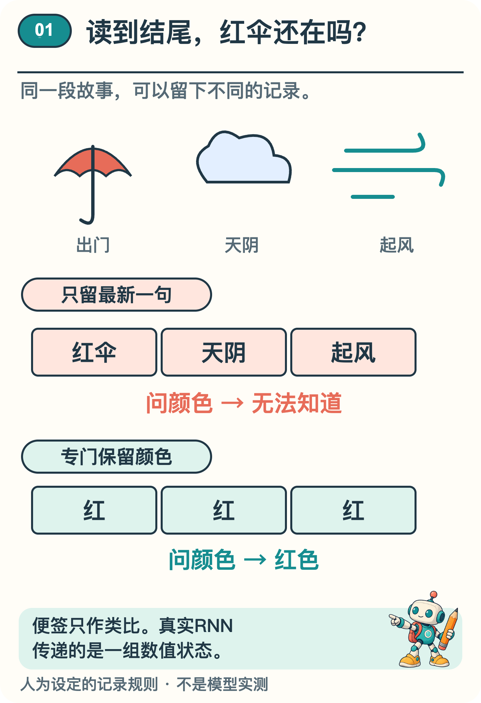
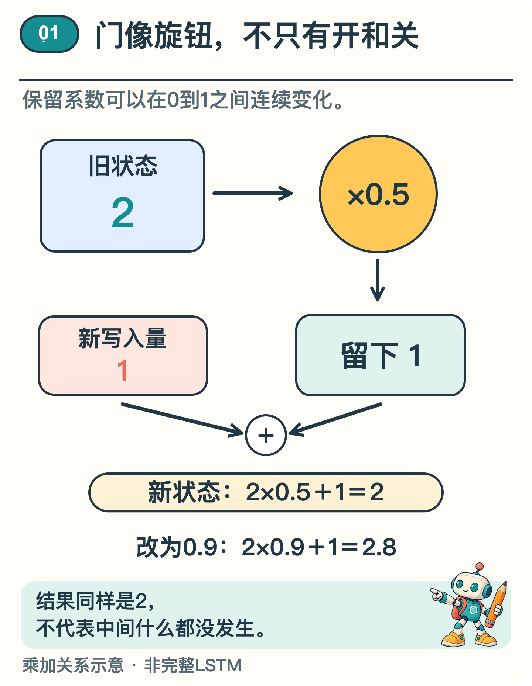

# 读到故事结尾，AI 怎样记住开头的红伞？

“小岚带着红伞出门。天渐渐阴下来，路上又刮起了风。”

现在问：伞是什么颜色？虽然最后一句已经说到风，我们仍能从前文找到“红色”。

假设你一次只能看一句，看完就要盖住，只准留一张便签。读到“风”的时候，纸上还得留着什么，才能回答刚才的问题？

## 先用一张便签看清问题

先用便签作类比。我们人为规定两种记法，把故事分成三步，最后再问颜色；这段演示并没有训练神经网络。

第一步，读到“小岚带着红伞出门”，便签写下“红伞”。第二步，读到“天渐渐阴下来”；第三步，读到“路上又刮起了风”。如果规定每次都擦掉旧记录，只留下最新一句，第三步的便签就只剩风，颜色已经无处可查。

换一个规则：便签专门保留伞的颜色，遇到天气变化时不覆盖它。第一步记下“红”，第二步仍是“红”，第三步也还是“红”。第四步问“伞是什么颜色”，凭留下的记录便能回答“红”。

*图1  便签类比中，天气覆盖旧记录会丢掉颜色；专门保留颜色的规则能在结尾回答红色。*

图1中，两条路线读到的故事完全一样。只留最新一句，就擦掉了颜色；把颜色保留下来，结尾才有依据回答。差别出在每次更新时留下了什么。

不过，“保留颜色”这条规则是人特意安排的：我们已经知道最后要问什么。它不能证明真实模型会自动保存所有重要信息。若问题换成“路上有没有风”，只有一个“红”字的便签也帮不上忙。

## 便签怎样换成数值状态

有一种处理先后顺序的模型叫循环神经网络。读到每一片新文字，它都带着上一步留下的一组数。这组数像那张便签，叫作状态向量。〔1〕“红伞”并不真的写在某张便签上，也未必有一个数专管红色。相关信息可能分散在多个数及其组合中。

每一步都用到当前输入和上一刻的状态。网络据此计算新状态，再把新状态交给下一步。怎样用新文字更新这组数，由网络的结构和一组可调的数决定。这些可调的数叫参数。〔1〕

把四步展开画，像是四个单元排成一列；实际上，它们用的是同一套规则和参数，每步变化的是输入与状态。训练要调整参数，使更新方式更适合任务；通常使用时参数不变，状态却会随着故事继续更新。就像同一个记事规则可以处理红伞故事，也可以处理蓝伞故事：读到不同内容，不需要先重新训练一遍，状态就可以不同。

这样，模型即使只在当前一步接收新输入，也可能通过状态利用更早的内容。但线索要经过一次次更新。旧信息可能被削弱，或与新信息混在一起，最后难以利用。循环连接提供了传递路径，但不保证模型永远记得住。

## 给状态通道装上可调的门

LSTM 是循环神经网络的一种，中文常译为“长短期记忆网络”。它设计了一条专门的状态通道，并用可调的“门”控制信息怎样经过。下面讲的是包含遗忘门的常见形式。〔2〕

可以把“门”想成调节比例的旋钮，图2演示的正是这样的变化。遗忘门调节旧状态保留多少，输入门调节新内容写入多少，通常给出0到1之间的系数。不同时间、状态中的不同数，都可以得到不同系数，并非只能全留或全删。

先把其中的乘加关系缩成一道示意算式，不还原完整 LSTM：旧状态是2，保留系数是0.5，本次新写入量设为1。

新状态＝旧状态×保留系数＋新写入量

代入之后，新状态＝2×0.5＋1＝2。新的2里，有1来自保留下的旧状态，另1来自新写入。虽然前后数值一样，保留和写入却都发生了。

*图2  简化乘加关系中，新旧结果都为2，也不代表没有更新。真实LSTM还包含其他计算。*

仍取旧状态2和新写入量1，把保留系数改成0.9，结果变为2×0.9＋1＝2.8。只改这一项，旧状态的影响就从1变为1.8。这展示了连续调节的意思；数值均为作者设定，也不代表某个颜色的编码。

完整 LSTM 还要计算写入内容，并用输出门调节状态中哪些数值影响当前输出。保存下来的状态与当下传出去的结果，是相关但不同的东西。〔2〕

门值由当前输入、先前状态和已学参数计算出来。训练调整相关参数，让网络有机会在合适的时候多保留、少写入。“门”是对数值调节的比喻。〔3〕

## 能传过去也可能慢慢变弱

沿用刚才的简化规则，假设后续三步都没有新写入，每步只保留一半。从2开始，数值依次变为1、0.5、0.25。信息的影响可以在反复更新中衰减。这里演示的只是数值变化，不能把这三个数直接换算成“还记得多少故事”。

## 颜色变了，便签也该更新吗

回到人为设计的便签规则。在天气变化后，再添一句“小岚把红伞换成了蓝伞”，然后问“她现在带的伞是什么颜色”。如果便签永远保留第一次写下的“红”，还能答对吗？

按这段故事，现在应记“蓝”。规则既要在天气变化时保留颜色，也要在换伞时更新颜色。“记得牢”不等于永不改写。这仍是便签练习，并不表示真实 LSTM 会把颜色存成一个字，或一定能判断哪一步该换。

LSTM 让保留与更新更容易分开控制，帮助模型处理相隔较远的线索，但它仍要靠训练学到合适的做法。状态大小、数据和任务都会限制效果，长故事里的细节仍可能丢失或混淆。

所以，这里的“记忆”是一份不断更新的数值状态，不是人的回忆体验。红伞能不能传到结尾，要看颜色线索经过多次更新后是否仍可利用。看懂每一步怎样保留和改写状态，就能更具体地理解模型为什么记得，或者为什么忘了。

## 资料来源

文中算例与图解用于说明原理，不是实际模型的测评结果。研究结论对应以下资料。

〔1〕 PyTorch，RNN（官方文档；复核日期：2026-11-12）。

https://docs.pytorch.org/docs/stable/generated/torch.nn.RNN.html

〔2〕 PyTorch，LSTM（官方文档；复核日期：2026-11-12）。

https://docs.pytorch.org/docs/stable/generated/torch.nn.LSTM.html

〔3〕 Gers、Schmidhuber、Cummins，2000，Learning to Forget: Continual Prediction with LSTM，Neural Computation 12(10):2451–2471。DOI:10.1162/089976600300015015。

https://doi.org/10.1162/089976600300015015
