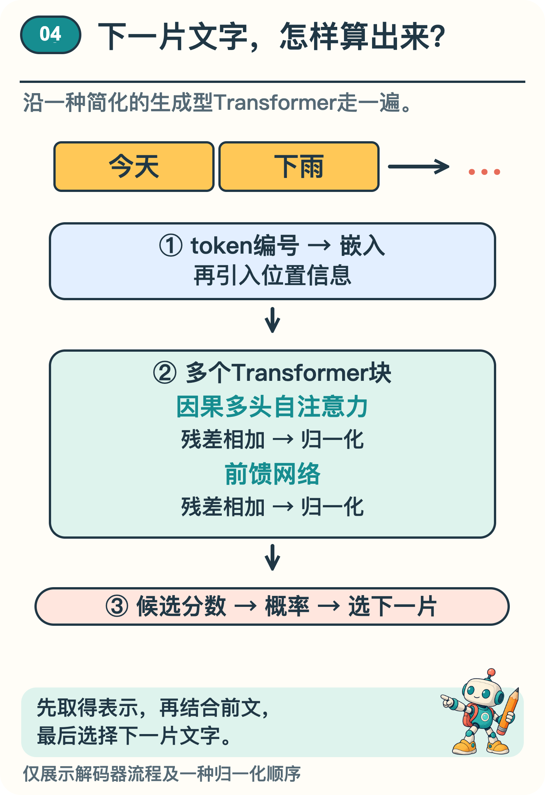
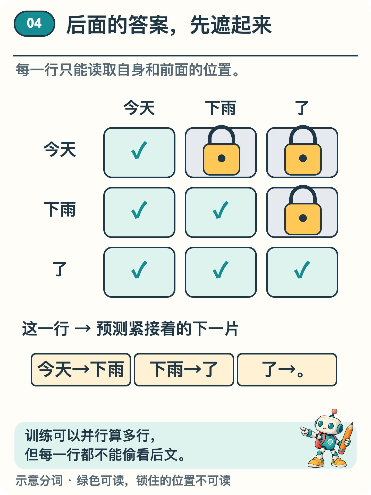

# AI 接出下一片文字前，里面发生了什么？

输入“今天下雨”，屏幕上接着出现“了”，然后是句号。只多了两个符号，模型内部却要做不少计算：把文字变成数字，联系前文，再决定接哪一片。

本系列第 2 篇看过怎样一片片接文字，本系列第 3 篇看过怎样把前文信息加权组合。这次把这些步骤接在一起，走一遍生成型 Transformer 的简化流程：文字怎样变成计算材料，前文怎样影响当前结果，最后怎样得到下一片的候选概率。〔1,2〕

> 第一次读，可以在纸上写下“今天／下雨”，跟着它走到句号。第二遍再回来看，每一步用到了哪个位置的信息。

## 文字先取得数字表示

先人为约定，把输入分成“今天／下雨”两个 token，也就是文字处理单元。真实分词器未必这样切分；一个字、一个词或词的一部分，都可能对应一个或多个 token。

token 先对应一个编号，再由编号查到一组表示它的数字。查找表示这一步叫嵌入，那组数字叫向量。编号只起索引作用，数字大不代表词义更强。

顺序也必须进入计算。“猫追狗”和“狗追猫”包含相同的字，意思却不同。本例把位置表示加到词的表示中；实际架构也有其他引入位置的方法。〔1〕

带着文字与位置信息的数字，接着进入多层 Transformer 块。一个“块”可以先理解为一组计算步骤，各层按类似结构处理信息，但通常拥有各自的参数。图1把这条路线放在了一起。

*图1  简化的生成路线。每个块包含注意力、前馈、残差与归一化，展开的模块见下文。*

## 一块里面有几种分工

第一项分工是联系上下文。沿用本系列第 3 篇的加权方法，让一个位置组合自身及前面位置的信息，暂不读取后文，这叫因果自注意力。“自”表示信息来自同一条序列，“因果”在这里说的是可读取的位置，并不是证明现实中的因果关系。多头注意力会同时做多组组合，再合并结果。〔1〕

第二项分工是加工当前位置。前馈网络变换每个位置的向量，并加入非线性处理，让计算不限于简单的倍数关系。这个子层对各位置使用同一套参数，但不直接把不同位置混在一起。〔1〕

把一个位置上的计算缩成一个数来看。原来是 5，这一步算出要补 2，就把原来的 5 留下来，加上 2，得到 7。这条保留原值、再加上计算结果的路线叫残差连接。换成一组数，就把对应位置的数分别相加。

这里的层归一化会根据当前位置一组数的均值和变化幅度调整数值，再作可学习的缩放与平移。它用于帮助训练更稳定，并不把这些数变成总和为 1 的候选概率；后面输出层的 softmax 才承担那项工作。〔1,3〕

这里采用的顺序是：注意力计算→残差相加→归一化，然后前馈计算→残差相加→归一化。其他变体可以把归一化放在不同位置。〔3〕

这些名字不必一次背完。沿图1走，先看谁负责联系上下文，谁负责加工当前位置，再看残差和归一化怎样配合。一个块的输出，会成为后续计算的材料。

这条专门接着前文生成的路线，常称为“只用解码器”的结构。2017 年原始 Transformer 用于翻译，还包括处理原文的编码器；本篇选看其中一种生成路线，没有展开原论文的完整架构。〔1,2〕

## 为什么训练时也要遮住后文

训练时有个容易“作弊”的地方。假设手里已经有完整的“今天／下雨／了／。”，预测“下雨”时却把后面的内容也交给模型，就可能把答案漏进去。正确的限制是：预测“下雨”只用“今天”，预测“了”只用“今天／下雨”。

因果遮罩负责阻断未来位置的信息。图2以输入位置为行、可读取的位置为列。每一行算出的结果，用来预测紧接在它后面的 token。〔1,2〕

*图2  每行只能读取自身及前面的输入，再预测下一token。灰色位置不可读。*

看图2的“下雨”这一行：它能读“今天”和“下雨”，而“了”所在的格子被锁住。计算注意力权重时，可以排除这些不允许的位置，使其权重为零。前面各层也要遵守同样限制，避免未来答案沿其他计算路线漏回来。

训练时，正确句子已经给定，所以许多行可以在遮罩限制下同时计算，并分别与正确的下一 token 比较。并行计算没有取消“不能偷看后文”的规则。

可以沿着图 2 自查：“预测『了』”对应哪一行？这一行能读取哪些 token？

答案是“下雨”这一行，它能读取“今天”和“下雨”，不能把目标“了”提前读进来。注意“这一行输入了什么”与“这一行要预测什么”相差一格。训练时可以把正确答案放在比较结果的一侧，却不能放进该行可读取的输入。

## 走完一次生成

回到输入“今天／下雨”。多层计算结束后，最后一个位置的表示进入输出层，得到词表中各候选的分数。分数通过 softmax 转成概率分布，再按设定的规则选出下一片文字。〔1,2〕

假设第一轮的候选是：“了”占0.60，“吗”占0.25，“，”占0.15。选择最高概率，就接上“了”。上下文变成“今天／下雨／了”。

第二轮假设“。”占0.80，“，”占0.20，最高概率选择得到句号。本例约定遇到句号停止，于是输出“今天下雨了。”这些概率由作者设定，不是模型实测。

第二轮能用到“了”，是因为第一轮已经把它选了出来。若先选“吗”，下一轮的上下文就不同；采用概率采样，也可能得到其他续写。这个过程一直使用已有参数，接回新 token 不等于重新训练。

实际程序可以缓存已算好的部分结果，减少重复计算。它仍需处理这里介绍的前后依赖关系。

生成开头的“了”和句号时，文字先变成表示，经过多层受遮罩限制的计算，再形成候选概率，供程序选择下一片文字。这解释了文字怎样接出来；今天究竟下没下雨，仍要靠外部证据。

## 资料来源

文中算例与图解用于说明原理，不是实际模型的测评结果。研究结论对应以下资料。

〔1〕 Vaswani 等，2017，Attention Is All You Need，第 3 节。arXiv:1706.03762。

https://arxiv.org/abs/1706.03762

〔2〕 Radford 等，2018，Improving Language Understanding by Generative Pre-Training，第 3 节（技术报告）。

https://cdn.openai.com/research-covers/language-unsupervised/language_understanding_paper.pdf

〔3〕 Ba、Kiros、Hinton，2016，Layer Normalization。arXiv:1607.06450。

https://arxiv.org/abs/1607.06450
