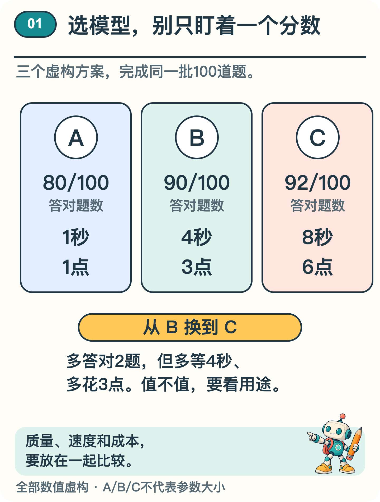
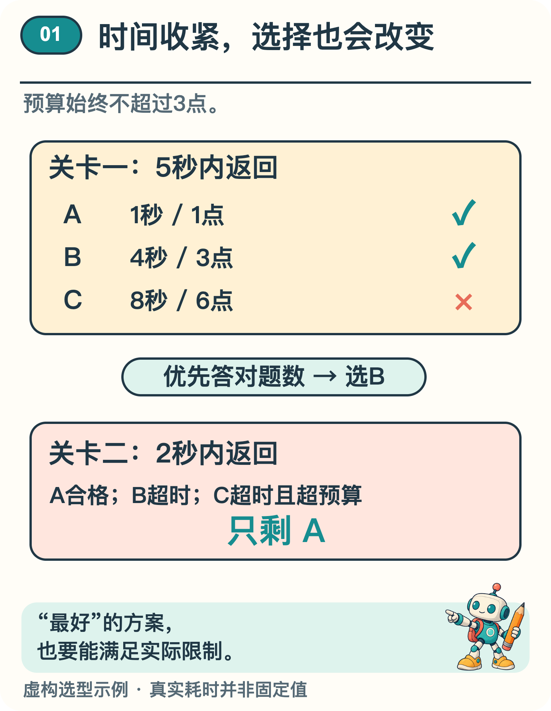

# 大模型越大，就一定越好吗？

假设班里要选一个 AI 答题助手。三个候选做同一套题，A 一秒给出一个答案，B 要四秒，C 要八秒。C 答对的题最多，就该选 C 吗？如果必须很快拿到结果，或每次只能花有限的费用，选择就可能改变。还要看它错的是哪些题。

有人会问：“能不能直接选最大的？”我们先看看这个“大”量的是什么，再回到班里的选择。

> 阅读提示：先分清参数、数据与计算量，再把 A、B、C 三个方案算到底。关于训练规模的研究放在文末选读。

## 大到底量的是什么

这里说的模型，就是收到题目、经过计算再给出答案的那套方法。模型里可以通过练习调整的数叫参数，数一数它们有多少，就得到了参数量。处理一个问题时，通常要靠许多参数共同参与。

训练数据量是另一个尺度。语言模型常按训练时处理过的 token 数计量；token 是文字处理单元，不必等于一个字。数据覆盖的情况、质量和重复程度，同样重要，只看数量会遗漏很多差别。

计算量记录的是训练做了多少数值运算。参数更多、处理的数据更多，通常需要更多计算，具体代价还受结构和算法影响。预算有限时，增加参数还是多用训练数据，就得作取舍，不能把每一项都当成免费增加的资源。〔1,2〕

## 把选择条件算到底

训练规模之外，还有日常使用的选择。下面用完全虚构的A、B、C三个方案算一遍：它们接受同一批100道题，假定每次请求的耗时和成本固定。这里的成本单位叫“点”，不对应真实价格，这组例子也不用来证明缩放规律。

A答对80题，耗时1秒，成本1点；B答对90题，耗时4秒，成本3点；C答对92题，耗时8秒，成本6点。A、B、C只是方案名称，不表示按参数量排序。

*图1  三项指标一起比较；所有方案与数值均为虚构示意。*

现在要求一次成本不超过3点，同时5秒内返回。在这个演示里，A的1点、1秒都合格；B的3点、4秒也合格；C的6点超过预算，8秒也超时。因此可行方案是A和B。如果在这些条件下优先选择答对题数更多的方案，就选B。

把时间要求收紧为2秒，预算仍是3点。A仍合格，B的4秒超时，C也超时且超预算，此时只有A合格。标准答案没有变化，资源限制一变，合适的选择就变了。

*图2  预算3点、时限5秒时A与B可行；时限收紧到2秒时仅A可行。*

从B换到C，在这组虚构成绩里，只多答对2题，却要多等4秒、多花3点。这是否值得，取决于多答对的是什么题、错误的后果多大。总成绩不足以判断方案是否适合具体场景。

现实中的等待时间还会变化。输入和输出有多长、使用什么硬件、同时来了多少请求，都会影响耗时。比较服务时，应尽量统一这些条件，还要留意特别慢的时候会慢到什么程度。图中的固定数值只用于这个算例。

## 资源还花在看不见的地方

模型运行需要存储参数和中间结果，也需要设备供电。某些场景关心总费用，某些设备受内存或电量限制；同样的模型，在不同硬件和运行方式上可能有不同表现。训练一次的成本，与长期服务很多次请求的成本，也应分开算。

工程方法能帮助利用设备。例如用于训练的 GPipe，把网络的不同层分到多台设备上，再把一批训练输入拆成小批次，像流水线那样交错处理。〔3〕它说明训练任务可以怎样安排，不代表把聊天服务接上流水线就一定更快，也不能自动保证每个回答更准确；设备之间传递数据还有代价。

实际选型时，还应拿接近用途的新例子检查：哪些题答得好，哪些题仍会失败，是否需要资料检索或人工复核。一个模型在平均成绩上占优，不等于它在每类输入上都占优。

回到开头，选择C还是A、B，要先把要求补全：处理什么任务，允许等多久，愿意花多少资源？规模研究帮助我们理解训练投入与表现的关系；实际使用时，要选的是在质量、速度和资源限制之间满足需要的方案。

## 自己改一项要求

仍用图中的三个方案，把条件改为「成本不超过 6 点，5 秒内返回，且这批题至少答对 91 题」，有没有合格方案？

先逐条筛选：A、B 虽能按时返回，答对题数却不够；C 答对 92 题，但要等 8 秒。因此这组条件下没有合格方案，不能为了选出一个就悄悄放宽要求。这也是选型可能得到的有效结论。

## 选读：训练规模与预测表现有什么关系

2020年，Kaplan等人比较了不同规模的语言模型。他们发现，在研究范围内，参数量、数据规模、训练计算量与语言预测损失之间存在可以用曲线描述的关系。这类经验关系通常称为缩放规律。论文用来衡量预测表现的指标叫交叉熵损失。〔1〕

这个名字先不用急着背。交叉熵损失关心的是：模型给真实出现的下一 token 分配了多高的概率。总体上，概率越高，损失越小。它衡量语言预测表现，不是给诚实程度或所有能力打总分。

有了这样的经验曲线，开发者可以估计增加资源可能带来多少收益，也能留意哪种资源已经成为限制。但曲线来自具体实验；换数据、结构、训练方法或评估任务，关系都可能改变。不能把它当成所有能力都会按同样速度增长的自然定律。

2022年的 Chinchilla 研究，把参数量与训练数据的配比放在一起考察：在近似相同的训练计算预算下，700亿参数的 Chinchilla 使用更多训练 token，与2800亿参数的 Gopher 比较。

论文表6报告，在每题前提供5个示例的设置下，Chinchilla 在 MMLU 的57项任务上平均准确率为67.6%，Gopher 为60.0%。MMLU 是一组覆盖不同学科的测试题。〔2〕

这项结果说明，较少参数配合不同训练投入，也可能得到更好的特定测试表现。它并没有证明小模型总胜过大模型；两者训练配置并不相同，这正是不能只拿参数量作判断的原因。

## 资料来源

文中算例与图解用于说明原理，不是实际模型的测评结果。研究结论对应以下资料。

〔1〕 Kaplan 等，2020，Scaling Laws for Neural Language Models。arXiv:2001.08361。

https://arxiv.org/abs/2001.08361

〔2〕 Hoffmann 等，2022，Training Compute-Optimal Large Language Models，第 4.2.2 节及表 6。arXiv:2203.15556。

https://arxiv.org/abs/2203.15556

〔3〕 Huang 等，2019，GPipe: Efficient Training of Giant Neural Networks using Pipeline Parallelism，NeurIPS。arXiv:1811.06965。

https://arxiv.org/abs/1811.06965
