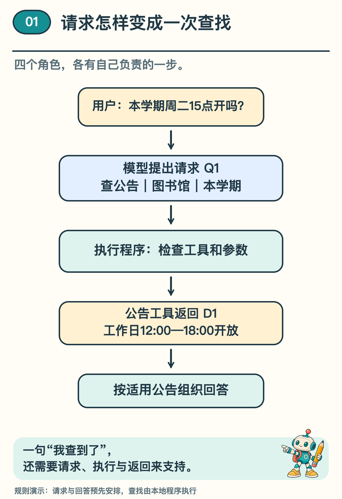
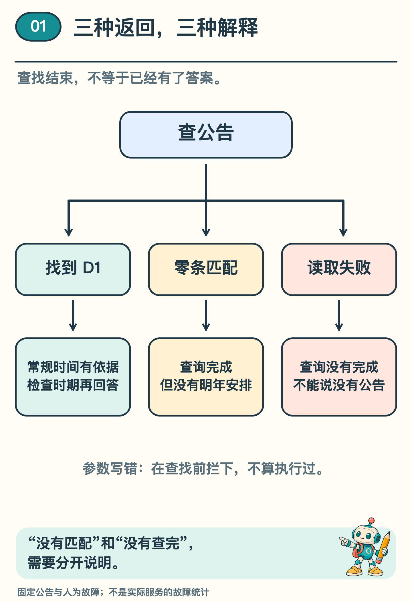

# AI 说「查到了」，真的查了吗？

「我查到了，图书馆周二下午开放。」

把这句回答遮住，翻开这次查找的记录。让一个本地程序去查校园公告，看看它带回了什么。

## 一句回答，还不是一次查找

假设学校有一份公告 D1：「本学期图书馆工作日 12:00—18:00 开放，周末闭馆。」我们问本学期一个普通周二下午三点，按常规安排开不开门。

两名同学都答「开放」。一名刚读过 D1，另一名记得上学期周二这个时候开过门。光看答案，你分不出谁核对了本学期的安排。

把查找过程分开看。你问“周二下午开门吗”；负责组织语言的模型可以提出“请查本学期的图书馆公告”；执行程序检查这项请求，再让专门查公告的小程序去翻资料。这个能被程序叫来做事的小程序，就是这里的“工具”。

下面用同一份公告演示。请求和回答由人写好的规则产生，代演模型的角色。检查请求、查找公告这两步由程序实际执行，所以我们能翻开记录，看看它收到了什么、又交回了什么。

*图 1　四个角色的分工。配套实验用预设请求代替模型的选择，其余校验、查找和返回由本地程序执行。*

## 把「帮我查一下」写成请求卡

在我们的设计里，公告工具叫「查公告」。就像去服务台查一份安排，要先说清查哪处设施、哪个时期，它也需要收到这两个条件。

这一次请求可以写成一张卡：请求编号 Q1，工具「查公告」，设施「图书馆」，适用期「本学期」。回来一份材料时，再看它对应哪张请求卡，就能把前后连起来。Q1 是本例安排的编号。

为了让程序认出这张卡，工具名称和条件都要放在约定的位置。程序才能读出「查公告」「图书馆」「本学期」，不用从一大段聊天文字里猜模型想做什么。

这样的分工也见于 CS329Z 的一份教学作业：学生要设计工具请求的格式，再让程序读取和检查。实际系统可以采用不同格式；共同要解决的，是把模型提出的动作交给程序处理。〔1〕

## 先检查卡片，再执行

执行程序拿到请求，先检查两件事：有没有这个工具，请求卡上的查找条件（工具参数）有没有按约定填好。

例如，模型把工具写成不存在的「查全部资料」，程序应返回工具未知。如果把必须填写的设施漏掉，就返回参数无效。这两种情况下，公告查找都不该发生。

通过检查后，程序才调用公告工具。工具可能正常返回，也可能在读取资料时出错。〔1〕请求写错了，要改请求；读取失败了，要处理工具故障。一律说成「没查到」，就藏起了问题发生在哪一步。

## 正常返回，也有不同结果

沿着 Q1 看配套程序的结果：工具正常返回，给出公告 D1 的标题、适用期和原文。规则程序据此填入的回答是：「按 D1 的本学期常规安排，周二 15 点开放。」

这时我们能检查一条完整路线：问题中的设施和时期进入请求；请求经过校验；工具返回适用公告；回答使用公告里的时间。

再把问题换成「明年周二开放吗」。假设资料库没有明年的公告，工具也可以正常完成查询，却返回零条匹配。这里的「正常」指查找操作结束，不代表找到了答案。

合理回答应说明现有资料没有明年安排。拿本学期公告补出明年的结论，仍然越过了证据范围。

第三种情形是工具读取失败。助手应说明查询没有完成，而不能说「已经确认没有公告」。没能查完，与查完后没有匹配，是两件不同的事。

*图 2　查找操作正常结束与是否有适用资料，需要分别判断。请求参数错误则会在查找之前被拦下。*

## 有调用记录，也要检查回答

现在再加一个条件：「今天临时检修，周二 15 点还开放吗？」

即使 Q1 成功取回 D1，也只能确认常规安排。D1 没有写检修期间如何处理，助手就不该用工作日开放时间保证现场一定开放。

这时，调用记录告诉我们「取回了 D1」，问题还要求我们判断「D1 能回答检修安排吗」。查找和使用资料，是前后相接的两件事。

可以按三个问题依次检查：有没有有效请求和执行结果？工具返回的材料是否覆盖问题中的条件？最后的每项事实能否从材料里得到支持？

前两步都正常，最后一步仍可能出错。例如，公告写的是 18 点闭馆，回答却写成了 19 点。工具成功，不会把错误回答变成正确答案。

## 用三张卡做一次判断

现在桌上有三张卡。

第一张只有一句「我马上查」，第二张是通过格式检查的 Q1，第三张把 Q1 与返回的 D1 连起来。哪张能证明有了查找意图，哪张说明请求可以处理，哪张才让我们看到返回的材料？

依次看这三张卡，就能发现证据一步步增加：承诺之后要有请求，请求之后要有执行结果，材料取回之后还要检查它是否支持回答。

再把第三张卡换成「零条匹配」或「读取失败」，试着各写一句回答。前者可以说「这次查询没有找到匹配公告」，后者应说「查询没有完成」。若把后者也写成「没有公告」，就把尚未查明的事说成了已经确认。

下一期，问题还会复杂一点：查到场地开放时间后，设备条件仍然未知。助手怎样接着查，又怎样知道该停下来？

## 想看程序怎样留下记录

选读：配套输出中，Q1 正常返回 D1；Q2 正常查完但列表为空；Q3 漏填设施，未执行工具；Q4 遇到人为安排的读取故障。这些记录依次使用 ok、ok、invalid_args、tool_error 状态。故障用于检查分支，不是学校真实发生的故障。

代码里的「查公告」叫 search_announcements，设施与适用期叫 facility、period。名称可以在 [本地实验说明](../../Python实现/source/campus_agent_lab/README.md) 和 [保存的输出](../../Python实现/source/campus_agent_lab/outputs/reference/episode17/result.json) 中对照；运行方法也放在那里，不影响正文阅读。

## 资料来源

学校、公告 D1、请求 Q1—Q4 均为原创构造材料。四种路径已由规则程序执行验证，未调用真实模型；条件变换练习为纸面推演。这里检查的是规则怎样执行，模型自主选工具的能力需要另外检验。

〔1〕 Stanford CS329Z，Assignment 1: Building an Agent Harness。参考工具注册、协议解析和 Agent 循环的接口说明；原仓库是需要学生补全的 starter。

https://github.com/cs329z/assignment1-harness/blob/95f4cb7bfe28a27a7cf5bcb1eccb1aaaf1385eb3/cs329z_hw1/adapters.py

https://github.com/cs329z/assignment1-harness/blob/95f4cb7bfe28a27a7cf5bcb1eccb1aaaf1385eb3/README.md
