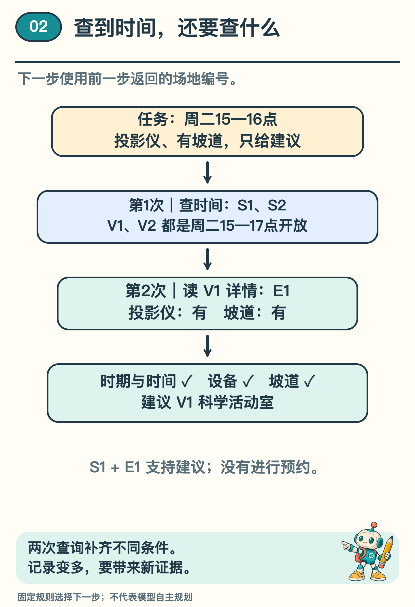
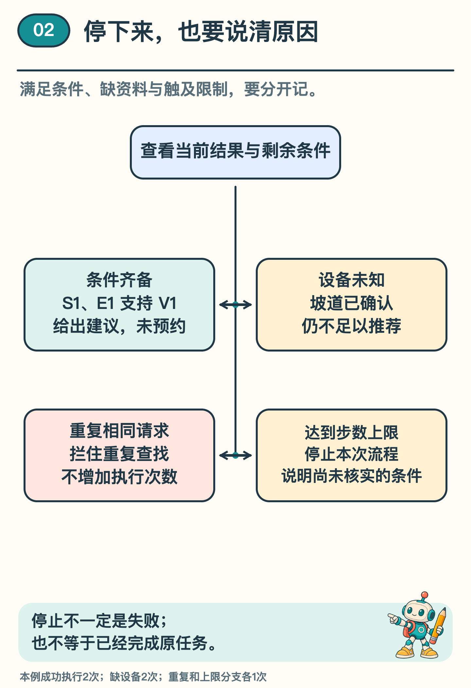

# 查一次还不够，AI 助手怎样接着做？

「科学社团想在本学期周二 15 点到 16 点活动，需要投影仪，场地还必须有坡道。帮我们找一个合适的地方，只给建议，不要预约。」

上一期，一次工具调用可以取回公告。这一次，查到开放时间还不够：时间合适的场地，可能没有设备，也可能没有坡道。助手要接着做什么，才有依据给建议？

还是那所虚构学校。我们用固定资料和一套预先写好的规则，把场地查找接着往下走，看看每一步补上了什么，又留下了什么。

## 查到候选，还没满足所有条件

先把任务中的条件列清楚：本学期、周二 15—16 点、投影仪、坡道。还有一句不能漏：只给建议，不去预约。

第一步，用「查场地」工具查时期、星期和起止时间。返回两个候选：科学活动室和阅览活动室，都是本学期周二 15—17 点开放。为方便前后核对，我们给它们编号 V1、V2，两份时间依据分别编号为 S1、S2。

15—16 点落在 15—17 点之内，因此两个候选的时间都合适。可是这份返回只回答开放时间，没有设备与坡道信息。此时直接选第一个，等于把两项未知条件当成了满足。

这时可以在记录中写下「时间已确认；设备和坡道待查」。就像查一张活动准备清单，已经有依据的项目先记好，下一步去补尚未确认的两项。

## 工具返回，变成下一步的材料

本例预先规定：按候选顺序查详情，遇到满足全部条件的场地就停止。于是第二步用「读场地详情」工具，带入 V1 这个编号。

返回 E1：科学活动室有投影仪，坡道记录为「有」。现在可以把四项条件逐一对上：时期与时间由 S1 支持，设备与坡道由 E1 支持。

程序给出建议：「可考虑科学活动室。按 S1 与 E1，本学期周二 15—16 点符合开放时间、投影仪和坡道条件；此建议未进行预约。」最初要求的只是找场地建议，流程走到这里就可以结束。

*图 1  成功路线共执行两次工具调用。第二次使用第一次返回的场地编号，最终建议同时依据 S1 与 E1。*

顺着这两步看，第一次返回的场地编号成了第二次查询的条件，第二次返回的详情又补齐了建议的依据。「接着做」因此有了具体含义：拿到结果，更新已知和未知，再安排下一步。

## 下一步，可以由谁决定

在这次演示中，顺序由人先写好：先查时间，再查详情；条件满足就建议，缺资料就停止。用固定路线看清步骤之后，还可以设想另一种安排。

也可以把任务要求、已有结果和可用工具交给语言模型，让模型提出下一次请求。程序检查请求是否有效、是否允许执行，再把执行结果送回模型。模型看到刚才查到了什么，才有机会调整下一步。

研究中的 ReAct 就采用了相关思路：模型写出处理问题的思路、提出行动，再利用环境的返回继续。它是一种代表性方法，并不是所有 AI 助手都走同一条路线。〔1〕

## 没查成，要走向不同出口

先换一份不完整的详情表：科学活动室的坡道写着「有」，设备一栏却没有记录。这个空白怎样填？它既不是「没有投影仪」的证据，也不是「有投影仪」的证据，只能先记作未知。

本例遇到这类缺口就先停下。因此两次调用后，程序说明科学活动室的投影仪尚未确认。阅览活动室的详情还没查到，结论应止于「目前依据不足」。若想再查另一个候选，可以另定继续查找的规则，给这一步留出次数。

如果工具报错，缺少的是本次成功读取的结果。可以说明失败发生在哪一步，再按约定决定是否重试；不能把错误消息当作一份场地说明。

再看一种原地打转：第一次查完候选，下一步又查完全相同的时期和时段，资料也没有变化。这次重复会被程序拦住。实际完成的仍只有第一次查询，第二张相同请求卡没有让我们多知道什么。

最后，假如这次只准查一次，会怎样？程序拿到两个候选后，次数就用完了。它应说设备与坡道尚未核实，保留这份未完成清单。这个上限是我们特意设置的，目的是看清「到上限退出」和「已经找到合适场地」的区别。

*图 2  停下来有不同原因。满足条件可以给建议；缺依据、重复查询和达到上限，需要说明未完成的部分。*

## 少一份表，接下来怎么办

试着审阅这条记录：已经收到 S1、S2，随后查询 V1 详情，E1 写着有坡道，设备记录却是未知。有人准备把 V1 的投影仪、坡道两栏都打勾，再发出建议。问题从哪里开始？

错误就在缺失的设备信息被当成了肯定证据。本例应按规则停止并说明未知。若另有可查的详情来源，可以在预算内继续查；若任务的时段或「有坡道」含义不清，才需要向用户澄清。再问一遍已经写清的时间，并不能补出缺失的设备表。

把几条路线并排看，调用多少次并不能单独决定好坏。两次查找可以补齐依据，也可以在缺资料时止步；只查一次，可能拿到候选，却还没有给建议的条件。应当顺着每一步问：刚才补上了什么，现在还缺什么，为什么在这里停？

下一期，我们再看一个问题：调用记录越来越长，最早的「必须有坡道」，还留在下一轮真正使用的输入里吗？

## 想沿着程序再走一遍

选读：[本地实验说明](../../Python实现/source/campus_agent_lab/README.md) 与 [本系列第 2 篇输出](../../Python实现/source/campus_agent_lab/outputs/reference/episode18/result.json) 保存了四条路线。成功和缺资料各实际执行两次工具调用，重复请求和一步上限各执行一次；被拦住的请求另记在过程记录中。

## 资料来源

场地、资料编号、任务和停止规则均为原创构造材料。配套程序已执行上述四条固定路线，行动顺序由规则安排，没有调用真实语言模型。读取报错一段说明可能遇到的另一种情况，不作为四条路线之外的实测结果。

〔1〕 Yao 等，2022 预印本／ICLR 2023，ReAct: Synergizing Reasoning and Acting in Language Models，第 2—4 节。arXiv:2210.03629。论文研究多跳问答、事实核查、文本游戏和网页任务等设置；本文借鉴行动与反馈交替的组织方法，本地规则演示与其模型实验分别看待。

https://arxiv.org/abs/2210.03629
