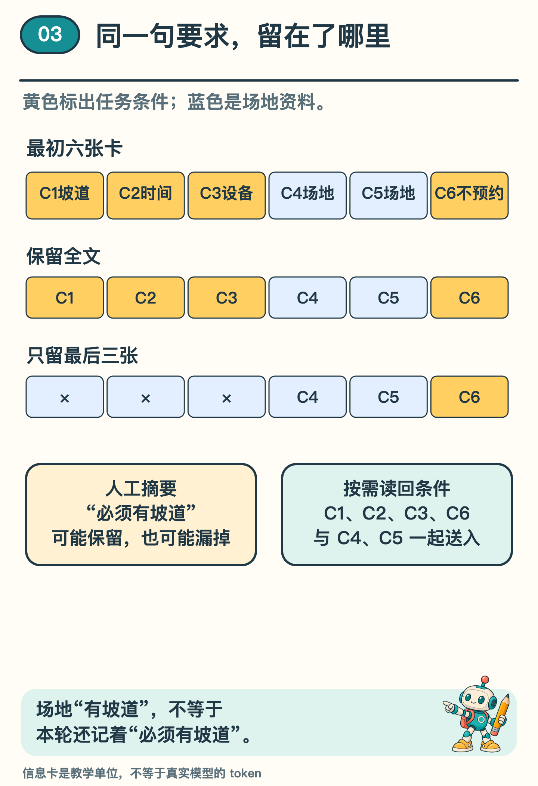
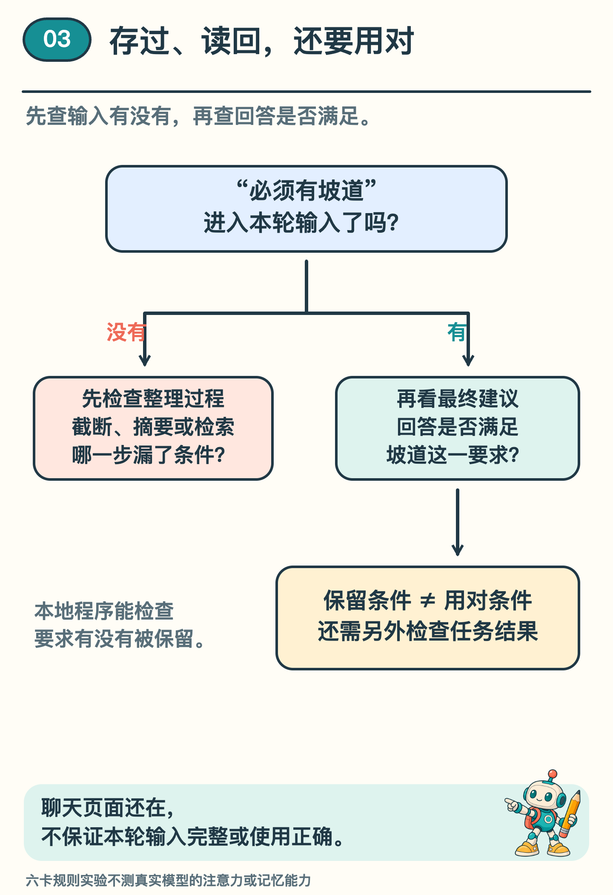

# 聊天记录越长，AI 就越不容易忘吗？

「场地必须有坡道。」这是我们最早说的一项要求。

后来，助手查了开放时间，又查了设备。聊天页面越来越长，新的场地记录不断出现。等到最后给建议时，这句话还在吗？它留在页面里，与它进入这一轮模型输入，是同一回事吗？

上一期，我们记下已经确认的条件，再决定下一步。这一期先不急着生成回答，把整个任务摆成六张信息卡，亲眼看看：同一份记录，整理方法变了，留下的内容会怎样变化？

## 先分清三个存放位置

模型参数是训练时调整的数值，决定模型怎样处理输入。它和请求卡上填的工具参数是两回事。你把“必须有坡道”写进聊天，变的是这次给助手的材料。

这一轮的上下文，是程序实际交给模型处理的输入。里面可以有任务要求、选定的聊天内容和工具返回。聊天页面像一本完整记录，当前输入却可能只是从中选出的一部分。〔1〕

还可以把原话单独存在文件里。轮到选场地时，程序得把“必须有坡道”从文件里找出来，放进这一轮输入，模型才看得见它。

所以，发现助手漏掉了坡道要求，可以先检查这一轮的输入。页面上还能翻到那句话，不代表程序这次也把它交给了模型。

## 六张卡，装进不同的输入

先摆三张写着要求的卡：第一张是「场地必须有坡道」，第二张是「本学期周二 15—16 点」，第三张是「需要投影仪」。

接着放两张查到的场地卡：科学活动室周二 15—17 点开放，有投影仪和坡道；阅览活动室同样时间开放，也有投影仪，却没有坡道。最后一张写着「只给建议，不预约」。六张卡依次编号为 C1 到 C6，方便挪动后仍能认出原来的位置。

第一种办法最直接：全部保留，C1 到 C6 都放进去。这是未经压缩的对照，用户要求和场地资料都还在。

第二种办法，只保留最后三张。C4、C5、C6 留下，C1、C2、C3 被截掉。两处场地事实还在，用户的硬性要求却丢了。仅看「V1 有坡道、V2 没坡道」，并不知道坡道是不是这次任务必须满足的条件。

就像把前半页撕下来，只拿最后半页去办事，场地事实还在，最初为什么挑场地却少了一部分。图中的三张上限是我们故意安排的实验条件，用来把这个变化显出来。

*图 1  全文、截断、摘要和按条件检索四类方法，留下的材料各不相同。摘要另写了保留与漏掉条件的两版。*

## 摘要短了，条件可能跟着少了

第三种办法，把历史内容整理成短摘要。人工写一版完整摘要，保留时期、时段、投影仪、必须有坡道，以及只建议不预约的边界。

再写一版漏项摘要，其他要求保留，却删掉坡道条件。两版都可以读得顺，长度也更短；只有回到原要求逐项核对，才能发现第二版少了一项。

不妨把两版摘要都交给另一个人，只问「坡道是不是必须有」。完整摘要能回答，漏项摘要却回答不了。读起来顺，并没有替代这项核对。

实际系统也可能使用模型压缩历史，但压缩需要决定保留什么；写得像一段完整的话，不保证保住了后面仍要用的约束。〔1〕

## 从外部记录把条件读回来

第四种办法，先保留外部原记录，需要做场地建议时，再检索任务条件。

配套实验按预定规则取回 C1、C2、C3、C6，再加上 C4、C5 的场地结果。这一次，「必须有坡道」重新进入输入，可以与场地条件一起检查。

取回来之后，还有一件事要核对：这是用户的要求，还是关于某个场地的事实？如果只找到 C4 中的「有坡道」，却没找到 C1，就仍然不知道用户是否把坡道列为硬条件。旧活动留下的条件，也要与这次任务分开。

读回后，六张卡又齐了。这次先在外面保存，需要时再取回；保留全文则一开始就把六张全交进去。两种办法都要检查：轮到给建议时，条件和资料到底有没有送到眼前？

## 信息还在，也不等于一定用对

到这里，我们检查的是第一层问题：坡道要求有没有进入输入。即使完整保留，还要问第二层：模型是否真的据此作了判断。

研究者也检查过这第二层问题。《Lost in the Middle》把含答案的材料放在长输入的不同位置，让当时几种模型回答问题。在多文档问答等设置中，相关材料位于中间时，常比位于开头或结尾时难以利用。结果随任务与模型而异，例如部分模型在合成键值查找中接近满分。〔2〕

六张卡让我们看见输入中还剩什么。至于模型会不会漏看或误用这些材料，还要看它实际怎样回答，不能由卡片齐全直接下结论。

*图 2  「要求被保留」与「要求被正确使用」需要分别检查。本地文本演示只检验前者，后者需要真实模型及任务结果的另外验证。*

## 给下一轮留一份可核对的记录

现在请把六张卡压成一份短记录，交给另一位读者，只看这份记录检查：哪个学期、哪天哪个时段、什么设备、坡道是否必须、允许做到哪一步？

如果其中一项无法确定，就回到原卡补充。不要从「场地有坡道」反推「用户要求坡道」，也不要把「没有写预约」当成明确允许预约。

沿着这份清单，就能把笼统的「又忘了」拆成两个问题：要求有没有进入当前输入，最后的建议有没有遵守要求？下一期，我们就把任务、查询记录和最终建议放到一起，继续检查第二个问题。

## 想看卡片怎样进入程序

选读：[本地实验说明](../../Python实现/source/campus_agent_lab/README.md) 与 [本系列第 3 篇输出](../../Python实现/source/campus_agent_lab/outputs/reference/episode19/result.json) 保存了六卡全文、末三卡、两版人工摘要和条件检索五组对照。程序只拼接、截取和查找固定文本；两版摘要由人事先编写。

它检查的是「必须有坡道」等固定条件短语是否留下，并非判断任意改写后的意思。卡片是本例的计数办法。真实模型把文字切成叫作 token 的小片段，一张长卡可能要占许多片。本例最后检索回六张卡，未测节省了多少输入空间。

## 资料来源

六张卡、两版摘要与检索规则均为原创教学材料。配套程序已运行输入整理与条件保留检查，没有调用真实模型。输入材料的保留情况与模型是否正确利用材料，在本篇中分别讨论。

〔1〕 Anthropic Engineering，2025，Effective context engineering for AI agents。参考上下文的组成、历史压缩与外部笔记读回的工程方法，不把其产品案例作为本地实验结果。

https://www.anthropic.com/engineering/effective-context-engineering-for-ai-agents

〔2〕 Liu 等，2023 预印本／TACL 2024，Lost in the Middle: How Language Models Use Long Contexts，第 2—3 节，arXiv:2307.03172。测试包括 MPT-30B-Instruct、LongChat-13B、当时版本的 GPT-3.5-Turbo 与 Claude-1.3，任务含多文档问答和合成键值查找。结论对应论文当时的设置，未外推到当前所有模型。

https://arxiv.org/abs/2307.03172
