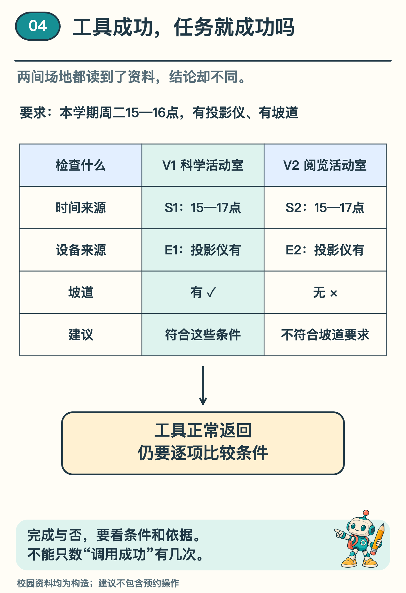
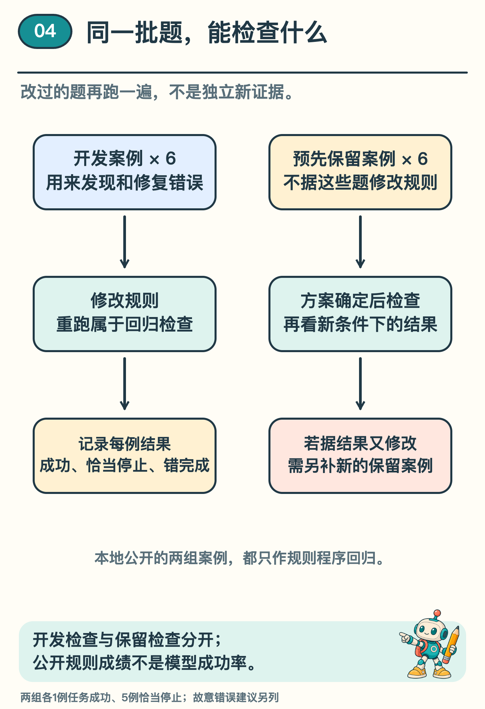

# AI 助手完成了任务，怎样证明它做对了？

「已经找好了，建议去阅览活动室。」

助手查过场地，也读过设备表，执行记录一条没少。可是，科学社团要求场地必须有坡道，而这间活动室没有。工具都正常返回，任务还是做错了。

前几期，我们追过请求，查过下一步用了什么资料，也检查了最初的要求有没有留下。这一期把它们放回那张场地清单：助手说「完成了」，我们该拿什么来核对？

## 先写清楚什么算完成

任务仍在那所虚构学校里：推荐一间本学期周二 15—16 点可用、有投影仪、有坡道的场地，并给出依据。只要建议，不要预约。

资料中，科学活动室 V1 与阅览活动室 V2 都在周二 15—17 点开放，时间来源分别为 S1、S2。设备表 E1 写明 V1 有投影仪和坡道；E2 写明 V2 有投影仪，但没有坡道。这些编号都是本例的构造标签。

把要求逐项列出来，就得到一份验收清单：安排适用于本学期吗，开放时间覆盖整个活动吗，投影仪和坡道是否都有依据？还要看看资料是不是说的同一间场地。只给时间一项打了勾，整张清单仍没有核对完。

*图 1　验收把要求与证据逐项对应；「调用成功」不能替代「结果满足条件」。*

科学活动室的两份资料覆盖全部要求，因此可以推荐 V1，并列出 S1 和 E1。如果回答还写「已预约成功」，就额外声称做过一次没有证据的操作，即使场地选对，也要指出这个错误。

## 把检查办法也提前写好

如果让另一个人帮忙检查，只交给他一句「看看它做对没有」，他可能也无从下手。需要交代三件事：原来要做什么，助手能查哪些资料、做哪些操作，最后按什么条件判定结果。CS329Z 的一份评测作业，也把任务按这样的三部分组织。〔1〕

在校园例子里，就要把场地要求、允许查阅的时间表和设备表，以及验收清单交给检查的人。还要告诉他：助手只能查询和建议，不能预约。有了这些，他就能逐项核对，不必凭回答听起来是否顺利来判断。

三个部分应在测试前写清。如果先看助手推荐了哪一间，再把要求改成那一间恰好满足的条件，分数就失去了意义。若设备表根本缺了坡道信息，也不能要求助手凭空猜中。

检查办法本身也值得试一试。把开头那条错选阅览活动室的建议交进去，如果因为出现了「完成」两字就放行，检查就失效了。反过来，「可以考虑科学活动室」与「建议科学活动室」意思相同，也不该仅因说法不同而被判成一对一错。需要对照的是建议的内容及其依据。〔1〕

## 把三种结果分开记

第一种是任务成功。助手找到 V1 的适用资料，确认时间、投影仪和坡道，给出有依据的建议。完成的证据是条件确实满足，不是查了几次。

第二种是恰当停止。假设 E1 的坡道信息缺失，V2 又明确没有坡道，现有材料不足以确认合适场地。助手说明缺口，结束建议，是合理处理。但原来的推荐任务尚未完成，不能把它算成一次成功推荐。

第三种是错误完成。例如助手读到 V2 没有坡道，仍推荐它并宣布满足全部条件。工具没出故障，错在没有按要求使用证据。因此，记录结果时要把成功、合理停止和错误完成分开，才能看清实际完成了多少任务。

至于查了几次、等了多久，可以另外记一笔，帮助比较效率。两次查询找齐依据，与反复查询后漏掉坡道，看起来都「做了不少事」，对任务的帮助却不同。把过程、最后结果和花费分开看，才容易发现真正需要改的地方。〔2〕

## 换一批题，才能问新的问题

在改进这套助手时，可以先用完整资料走一遍，再换几张卡：删掉设备信息，把时间表换成过期安排，或者故意让读取失败。每换一种情况，都看看助手是否说清了做到哪里。发现错误、修改、再用原题核对，这叫回归检查。

还有一个不同的问题：换一批没用来修改方案的题，助手会怎样处理？为此，可以事先留出另一批案例，等方案确定后再打开。就像练熟一张卷子之后，再拿一张新卷子看看学得怎样。若看过结果又据此改规则，这批题也就成了练习的一部分。

*图 2　同一批题修改后重跑属于回归检查；公开的教学用例不等于独立模型评估。*

这个系列也准备了 6 个开发案例与另编的 6 个保留案例，把每题的资料、结果和工具次数列出来，供大家沿着过程检查。现在这些例子都已经公开，并共同用于核对规则程序。它们是可查看的教学题，不再是一份未打开的新卷子。

以后若接入真实模型，就要另外准备合适的检查题，说明用了哪个版本、给了哪些材料、允许哪些工具，并保留每次尝试。只展示最好的一次，别人就看不到同一任务还有多少种结果。

## 找到第一次偏离要求的位置

现在审阅一段纸面记录：任务要求包含坡道；查询返回 V1、V2 的时间表；助手选择读 V2 的设备表；E2 返回「投影仪：有，坡道：无」；最终回答「V2 符合全部条件」。

哪一步第一次明确违背了任务？选择读取 V2 并不算错，它可以是在排查候选。真正的问题出现在拿到「坡道：无」之后，仍把 V2 判为合格。只看最终语气，找不到这个原因；对照条件和证据，才知道该修什么。

回看科学社团的场地清单，你现在可以指出这条建议错在哪儿，也能拿出设备表上的那一行，让别人照着查一遍。

这几期的小程序按人写好的规则办事。换一条建议来，你也可以照这样查一遍：找出原来的要求，翻到对应的资料，看看哪一步有了依据，哪一步还欠一句交代。

## 想自己核对每一道题

选读：[本地实验说明](../../Python实现/source/campus_agent_lab/README.md) 与 [本系列第 4 篇输出](../../Python实现/source/campus_agent_lab/outputs/reference/episode20/result.json) 保存了两组六题。每组都是 1 次任务成功、5 次恰当停止：后五次没有完成推荐，只是按情形说明原因后停下。两类结果分开记录，才能看清真正完成了多少任务。

程序还单独安排了一条漏掉坡道的错误建议。验收逐项读取原始要求、场地资料和本次查询记录，坡道一项不符，便把它判为错误完成。这条错误是为检查验收办法故意设计的，不是真实模型犯错的记录。

## 资料来源

校园、场地、资料编号与执行情形均为原创构造案例。配套规则程序已经运行这些教学题，没有真实模型参与。这里的检查支持对照这套规则的过程与结果；模型在新任务中能做多好，需要另行评估。

〔1〕 Stanford CS329Z，Assignment 2: Building an Evaluation Task，版本 26.1.0，§1.1、§4.1—4.3。参考评测的三部分、验证器检查与保留全部运行结果的要求。

https://github.com/cs329z/assignment2-evals/blob/3a649d8da0dc6cb0422e6ce7ce7068c3b98be1db/cs329z_assignment2_evaluation.pdf

〔2〕 Stanford CS329Z，Assignment 1: Building an Agent Harness，adapters.py 中 run_agent_session 的 agent_loop 接口说明。参考轨迹、停止状态及预算的区分；原仓库为作业骨架。

https://github.com/cs329z/assignment1-harness/blob/95f4cb7bfe28a27a7cf5bcb1eccb1aaaf1385eb3/cs329z_hw1/adapters.py
