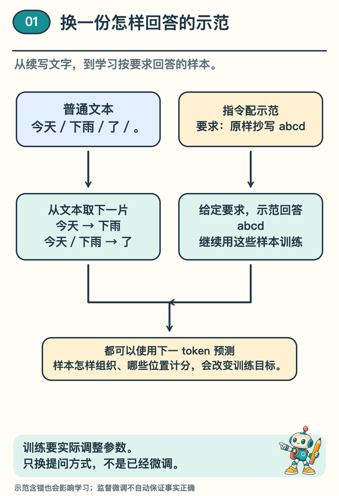
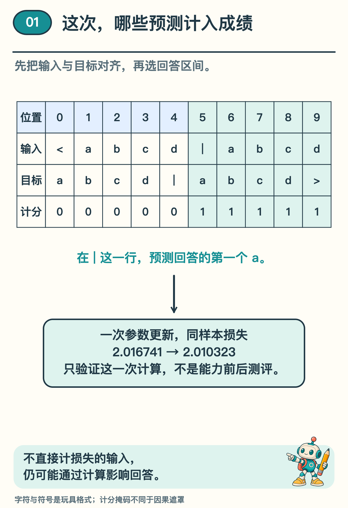

# 从续写到按要求回答，中间训练了什么？

「请把 abcd 原样抄写出来。」

假如 AI 接着写「抄写要保持字迹工整」，这句话读得通，可你纸上要的四个字母一个也没拿到。抄写题的好处是，照着原文就能核对。

这里用的语言模型会根据已有文字，一片一片往下接。现在换个座位，来给它出练习题。要让它学着按要求回答，你会把哪段文字给它看，又给它写的哪几片打分？

## 从文本里取得下一片的目标

出第一道题，只要一句现成的话。先盖住后半句，让模型给接下来可能出现的文字片段（token）各算一个概率。揭开下一片，就有了核对的答案。

例如，文本是「今天／下雨／了／。」。把它向后错开一格，就有「今天」后预测「下雨」、「今天／下雨」后预测「了」等练习。假如原文的下一片是「了」，模型却只给它很小的概率，这一题就要多扣分。训练时用一个数来衡量这种偏差，叫损失。程序根据损失，调整模型里用来算预测的一些数；这些可调的数叫参数。〔1〕

在这条路线里，先用大量文本做这样的学习，叫作预训练。

练习材料里有问答，有故事，也有错误的说法。模型从中学到词句和格式的规律，有时也能照要求回答。不过，遇到「请把 abcd 原样抄写出来」，接一段关于抄写的议论，在文字上也说得通。怎样让它多练一练我们期待的答法？

## 换成「要求＋示范回答」

另一种数据组织方式，把指令与希望出现的回答配成一组。例如：要求「请把 abcd 原样抄写出来」，示范回答「abcd」。再加入翻译、概括、按指定格式填写等不同任务的示范，展示在这些条件下应怎样回答。

在预训练模型上，用这样的示范继续训练，是监督微调的一种用法，常缩写为 SFT。InstructGPT 研究就先收集人写的示范，再用它们继续训练模型。〔2〕关键不只是把指令放在前面，还要给出希望模型学着生成的回答。

*图 1  两种样本都能采用下一 token 预测。指令样本明确区分给定要求与示范回答，不等于更换了全部模型结构。*

回答示范还需要质量检查。若示范把「原样抄写」答成「dcba」，训练程序不会仅凭降低模仿损失，就自动知道这违反了要求。数据和目标怎样设计，会影响模型被推动着学习什么。

## 哪些位置直接计入损失

一种常见设置，只给回答 token 的预测计损失。指令照常交给模型，但不要求它也学着生成用户说的每一句话。有些实现会给整个序列计分，所以「SFT 永远只算回答」并不准确。〔3〕

用配套程序的一条小序列看清位置：`<abcd|abcd>`。在这个教学词表里，每个符号各占一个 token，`<` 是开头，`|` 分开给定部分与回答，`>` 是结束。它表示一条复制练习，不是任何真实聊天产品的统一格式。

如果把全部下一片预测都计分，一共有 10 个目标：`a b c d | a b c d >`。如果只计回答区间，则计后面的 `a b c d >`，共 5 项，包括学会结束的标记。

用纸盖住竖线右边的 `abcd>`。模型刚读到 `|`，就得猜下一片。揭开第一个 `a`，这时才有答案给刚才那一猜打分。等模型读到这个 `a`，它要猜的已经是 `b` 了。

*图 2  十个预测位置的计分开关为 0、0、0、0、0、1、1、1、1、1。0 表示该项不直接计入损失，1 表示计入；这不是注意力遮罩。*

这些开关叫损失掩码，可以理解为「哪些预测列入这次成绩」。刚才盖住后文的纸管的是“能看哪里”，模型里起这个作用的叫因果遮罩。图里的计分开关管的是“哪一猜算成绩”。

不为指令侧的预测计分，指令仍然要读。模型可以通过注意力利用它来回答，回答的损失也可能沿着这些计算影响参数。如果直接删掉指令，模型收到的问题就变了。

## 用同一条练习，再算一次损失

现在用同一道抄写题做两遍。第一遍算完损失，程序按这次结果调整参数。再把原题交给它，按原来的五个位置计分。这样就能看见，改了参数以后，同一道题的成绩变了多少。

配套小程序实际做了一次这样的更新。同一条复制练习的回答区间损失，从约 2.017 降到 2.010。变的是参与计算的参数，没有人把目标「abcd」偷偷改成模型第一次给出的结果。

这次更新只让同一条练习的计分结果改善了一点，还看不出模型能否完成新指令。这个小网络没有经历完整的预训练和指令微调；我们用它看清哪些位置计分、参数怎样更新。新任务做得怎样，还得另出题检查。

与之相对，只把提问改得更清楚，或在输入里放几组示范，而不运行参数更新，属于改变提示与上下文。它可以改变这一次的输出，但不能把这项操作称为已经微调了模型。

## 遮掉的是成绩，还是输入

请检查三个判断：「指令侧不计损失，所以可以把指令删掉」「改了提示词，就完成了 SFT」「这条复制样本损失下降，说明新问题都能答对」。

三个判断都越过了证据。第一句混淆计分和读取；第二句没有发生参数训练；第三句把单条训练样本的变化外推到了新任务。能指出差别，比只记住一个 SFT 缩写更有用。

监督微调可以引导模型学习示范中的回答方式，却不会让一段回答自动获得现实证据。示范不完整、事实过时或换一种问法，都仍需要检查。后续还可以学习人类偏好等训练方法，常见的 RLHF 就属于这类延伸；本篇没有运行它。〔2〕

从续写到按要求回答，改变的是训练资料如何组织、目标怎样选择，以及参数怎样据此调整。看懂这几步之后，下一期再问一个运行问题：已经学好的模型每接一片文字，有哪些计算可以复用？

## 选读：这次小实验怎样留下记录

固定样本为 `<abcd|abcd>`，十个下一 token 预测位置从 0 起编号，只选索引 5—9 计损失。程序用学习率 0.01 更新一次参数，损失由 2.0167406472189926 变为 2.010323355708571；上文只保留三位小数。被遮掉的预测分数没有直接损失梯度，输入仍可通过注意力影响回答计算。

实现与固定结果见[训练、缓存与专家路由实验说明](../../Python实现/source/continuation_mechanisms/README.md)。它不是完整大模型训练，也没有测新指令的完成率。InstructGPT 原研究在监督微调之后还进行了回答比较、奖励建模及强化学习，这些阶段没有在本实验中实现，原研究整条路线的结果也不能都归给 SFT。〔2〕

## 资料来源

抄写案例与符号格式为原创教学设计。实验数字取自同一固定样本的一次更新；正文三位小数为舍入，选读部分保留原记录。

〔1〕 Radford 等，2019，Language Models are Unsupervised Multitask Learners，第 2 节。参考自回归语言建模目标，不使用论文性能数字。

https://cdn.openai.com/better-language-models/language_models_are_unsupervised_multitask_learners.pdf

〔2〕 Ouyang 等，2022，Training language models to follow instructions with human feedback，InstructGPT，第 3.1、3.5 节及局限讨论。arXiv:2203.02155。监督微调与后续偏好训练分开说明。

https://arxiv.org/abs/2203.02155

〔3〕 Hugging Face TRL，SFT Trainer 官方文档，Train on completion only、Train on assistant messages only、Computing the loss。复核日期：2026-11-13。参考回答区间与全序列损失可选设置，不要求读者运行该工具。

https://huggingface.co/docs/trl/sft_trainer
