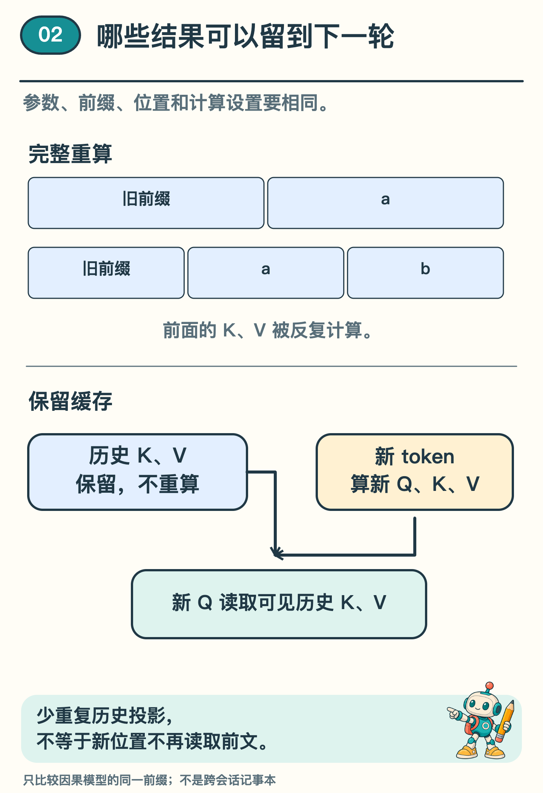
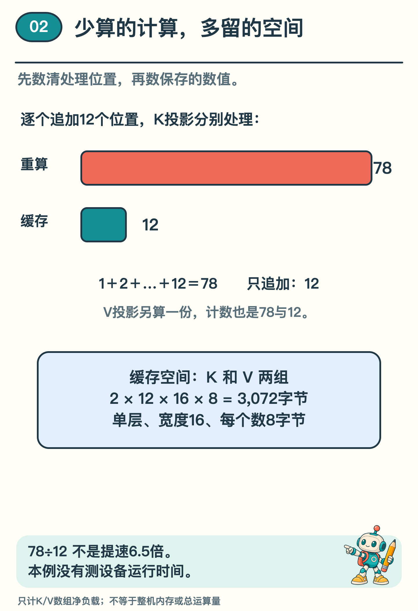

# 接出下一片文字时，哪些计算可以复用？

玩文字接龙时，新接上的字会成为下一步的线索。AI 逐片写回答，也会把刚选出的文字接回前文。开头明明没有改，每接一片，却要把前面的计算重做一遍吗？

上一期，我们圈出了抄写题里哪些位置要打分。这次固定住模型的参数，看看它每接一个字母要做哪些计算。这里的一「片」仍指 token，在自然语言里不一定是一个汉字。

想想草稿纸：上一轮的算式里，哪些结果可以圈起来，下一轮直接用？先跟着模型抄两个字母，再看能留下哪些数。

## 在末尾添一个字母，前面的计算会变吗

想象一个极小的复制任务：给模型 `<abce|`，让它接出 `abce>`。这个例子把每个字符都当作一个 token，开头六个字符就是六个输入位置，不是自然语言中的通用分词规则。

第一轮，模型处理这六个位置，给下一片文字算分。选出 `a` 以后，把它接回输入，第二轮面对七个位置；接着选出 `b`，第三轮面对八个位置。

到目前为止已经有的这段文字，叫前缀。一种做法是每次都把完整前缀从头算一遍。这样算第二轮时，前六个位置就又处理了一次。

这个小模型采用一种逐片生成的结构，叫因果 Transformer。里面的注意力计算负责从文字的不同位置取用信息，每个位置只能读取自己和更早的位置。所以，末尾多来一个 token，不会反过来改变旧位置的结果。这里要保持模型参数、前缀和位置规则不变，计算设置也要让相同输入能够重现相同数值。条件相同时，旧位置的结果才可以接着用。〔2〕

*图 1  两条路线使用相同参数和前缀。缓存路线仍须让新位置读取历史信息，并非把旧文字从计算中删除。*

## 把前面算过的两组数留下

看图 1 里的 K 和 V。模型为每个位置算出两组数：一组供别的位置来匹配，叫键（K）；另一组装着这个位置可供取用的信息，叫值（V）。新位置还会算出自己的查询（Q），拿它与各个键比较，决定从每份值里取多少。〔2〕

把旧位置的键和值存下来供下一轮使用，就叫键值缓存（KV Cache）。〔1〕

缓存路线先处理六个输入位置，把各位置的 K、V 存下来。下一轮只接入新来的 `a`，计算这个新位置的 Q、K、V，再把新 K、V 追加到缓存。

新 Q 仍要与允许读取的历史 K 计算注意力分数，再用得到的权重组合 V。省下的是旧位置的一部分重复计算；跨位置读取仍然发生，而且可读取的历史会继续变长。

缓存名里只有 K、V，也是这个原因：下一轮要用新位置的 Q 重新查询前文，上一轮的注意力权重不能直接照搬。两条路线的候选分数要逐项比较；浮点计算可能有微小误差，检查时应先约定允许差多少。

## 留下来的数，还能不能接着用

如果两条路线最终都选了 `a`，就说明缓存正确吗？还不够。即使候选分数已经不同，排在第一位的仍可能碰巧是 `a`。应该把同一前缀下各候选的分数拿来逐一比较。

本仓库用小 Transformer 实际作了这个比较：在相同参数、相同前缀和位置条件下，完整重算与缓存路线的候选分数之差，接近这次浮点计算的误差范围。这支持这版实现的复用方法，不是在证明它写得更好。〔3〕

还有一个很容易漏掉的细节：新 token 的位置要接着排。六个位置已经用过，新位置就不能又从最初的位置编号开始。

配套实验故意把新位置编号重置，再作比较，两条路线的分数就明显不同了。旧缓存即使保存得好，位置错了，也不再代表同一次计算。模型换了参数、前缀被改写等情况下，也不能未经检查就接用原缓存。〔1〕〔3〕

## 用十二个位置算一笔账

来核对配套实验里的一个计数。它依次处理长度为 1、2、3，直到 12 的前缀。从一个位置的数字表示算出它的 K，叫作 K 投影。先只数 K 投影处理了多少次位置，V 投影另算一份。

完整前缀路线每次从头做 K 投影，处理的位置次数是：1＋2＋3＋……＋12＝78。

缓存路线每次只为新增的一个位置做 K 投影，合计 12 次。历史 K 留在缓存里，不重复投影。V 的计数也分别是 78 与 12。

历史位置的投影确实减少了。算出 78÷12＝6.5，却还不能说硬件快了 6.5 倍：我们只数了 K、V 各自处理的位置，没有数完整运算量。新位置仍要读取越来越长的历史，保存和读取缓存也有开销。本次实验没有测实际耗时。

*图 2  位置计数与 K/V 数组空间的教学算例。它们不是总运算量或整机内存的测量。*

## 计算少重复，空间却要多留

这次小模型是单层、单头，每个 K、V 都有 16 个数，采用每个数占 8 字节的 float64。每多保留一个位置，两组向量合计增加 2×16×8＝256 字节。

增加到十二个位置，K/V 数组净占 12×256＝3,072 字节，与保存结果一致。这里只数 K、V 数组，没有加上参数、临时数组、程序对象或其他开销。真实模型的层数、向量尺寸、数值精度和缓存实现不同，空间也会不同。

可以自己检查：如果只比较长度为 1 至 4 的前缀，K 投影两条路线各处理几次位置？答案是完整前缀 1＋2＋3＋4＝10，缓存 4 次；V 各有相同计数。最后缓存四个位置的 K/V，净占 4×256＝1,024 字节。注意，不能把「有 K、V 两组数组」忘掉。

最后，缓存也没有把这段话变成跨会话记忆。它是特定前缀、参数和位置条件下的中间计算结果；换一个任务想长期保存资料，仍需要另外设计存储与检索。

这次我们看到一种取舍：留住一部分中间结果，少做重复计算，同时付出空间与读取开销。下一期再看另一种省计算的思路：同一片文字，是否一定要经过全部「专家」？

## 选读：配套程序具体比较了什么

程序固定一段 12 个 token 的输入，依次比较长度为 1 至 12 的前缀。两个固定种子的随机模型，加一个随包历史模型，共有 36 组对照；每组的两条路线使用相同参数。比较的是下一 token 的原始候选分数，也叫 logits，最大差约为 7.11×10⁻¹⁵。错误重置位置编号的负例，最大差约为 20.33。〔3〕

这些检查没有测续写质量，也没有测设备上的实际耗时。输入、实现与保存结果可沿文末实验链接复查；它们支持本例的数值比较，不覆盖所有模型和缓存实现。

## 资料来源

文中误差与缓存净字节数来自配套数值实验，位置投影计数也可按给定长度手算。没有进行设备性能测评。

〔1〕 OpenAI，GPT-2 官方实现 `src/model.py`。`attn` 将历史 K/V 与新 K/V 连接，`positions_for` 根据历史长度安排新位置；这里参考计算机制，不复现其全部架构。

https://github.com/openai/gpt-2/blob/master/src/model.py

〔2〕 Vaswani 等，2017，Attention Is All You Need，第 3.1—3.2 节。参考查询、键、值与因果掩码；原论文为编码器—解码器架构，本文没有把两者混作同一个模型。

https://arxiv.org/html/1706.03762v7

〔3〕 本仓库续篇机制实验的缓存对照，沿用 T08 参数；实现、固定输出与适用范围见实验说明。

[训练、缓存与专家路由实验说明](../../Python实现/source/continuation_mechanisms/README.md)

[固定结果的 kv_cache 字段](../../Python实现/source/continuation_mechanisms/outputs/reference/result.json)
