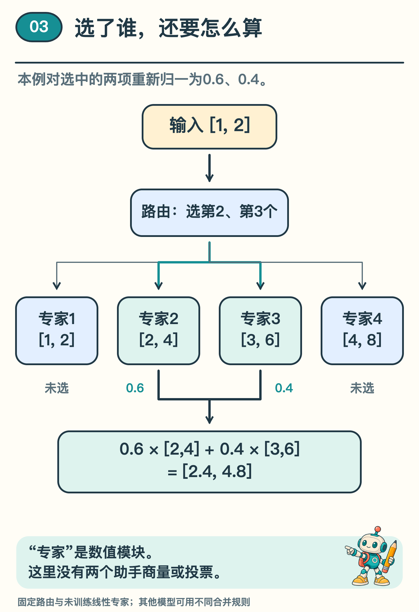
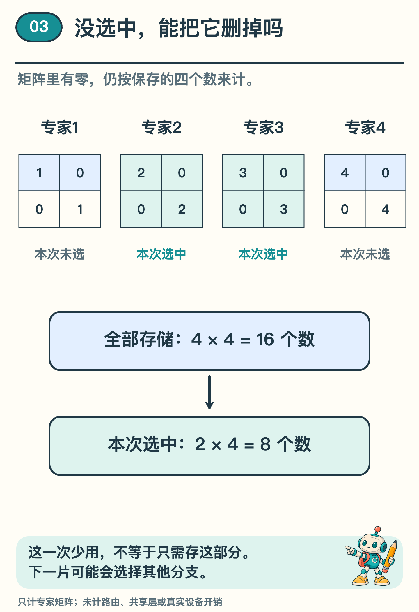

# 每片文字，为什么只交给部分「专家」？

手机里的一句提问送进大模型后，模型是不是每次都要动用全部计算模块？如果准备了四个模块，这次只请其中两个处理，最后又怎样把结果合起来？

前一篇通过缓存省去重复计算。这一篇看另一种安排：把一些计算交给多个候选模块，再按输入选择其中一部分。它常被称为稀疏混合专家，简称 MoE。这里的「专家」是数值模块，不一定对应语文、数学等人的学科。

我们先把真实模型缩成一个可以手算的小例子。所有输入、分数和模块都由我们设定，没有训练专家，也没有比较模型能力。配套程序只负责复算路由与合并。

## 四个模块，先各算一次

输入用两个数字表示，写成 `[1, 2]`。准备四个模块：第一个把两个数各乘 1，第二个各乘 2，第三个各乘 3，第四个各乘 4。

因此，它们分别会给出 `[1, 2]`、`[2, 4]`、`[3, 6]`、`[4, 8]`。这里先全部写出，是为了核对算术；实际选择流程不需要每次都执行四个模块。

还缺一个决定由谁处理的部分，叫路由器。可以把它想成一个会给候选模块打分的程序。在真实模型里，这些分数通常来自可训练的计算；本例直接固定分数，只演示后面的选择。

要注意，分数是用于路由的数值，不是「这个专家回答正确的概率」。某模块得分最高，也不能直接翻译成它最懂这个话题。

## 选中两个，再把权重算清

本例按分数选中第二、第三个模块。只在这两个选中项之间重新分配权重，分别取 0.6 和 0.4，加起来等于 1。未选中的第一、第四个模块不贡献本次输出。

把第二个模块的 `[2, 4]` 乘 0.6，再把第三个模块的 `[3, 6]` 乘 0.4，逐项相加：第一项为 2×0.6＋3×0.4＝2.4；第二项为 4×0.6＋6×0.4＝4.8。最终得到 `[2.4, 4.8]`。

*图 1　先选择，再计算选中模块的输出并加权；这是一组未训练的构造算例。*

可以沿图 1 倒着检查：要得到 2.4，第二、第三个模块分别贡献了 1.2 和 1.2；要得到 4.8，两边分别贡献 2.4 和 2.4。选中两个以后，仍要知道各自给出了什么、占多少比重，才能复原最后的结果。

下一片文字的数字表示变化，路由器就可能选择不同模块。但「可能换路」不等于每片文字必须走不同路线，连续多片也可能选中同一组。

这里的两个专家也没有先商量、再投票。它们各自算出数值，按权重合在一起。模型内部的这种计算，和两个独立助手各写一份答案，是不同的过程。

本例把选中两项的权重重新调整，使它们相加为 1，这叫重新归一。其他稀疏路由可能有不同约定，不能直接照搬。因此，看一张专家分工图，不只要看哪两条线亮了，还要看它们怎样合并。

## 少用一部分，为什么还要存全部

在图 2 里，每个模块的参数排成两行两列，这样的数字表叫 2×2 矩阵。数一数，连同表里的零，每个模块都要存四个数。四个专家总共保存 16 个数；本次选中两个，使用其中 8 个数。

16 个数是四个专家都要存下来的；8 个数是这次选中的两个专家所包含的。第一、第四个模块这次虽然没用，下次可能会选中，所以仍要保存。

*图 2　这里只统计专家矩阵，不包括路由器和共享层；保存量与本次选中量不能混用。*

真正的语言模型还有注意力层、路由器以及其他共享计算。所以，某层只选一半专家，不等于整个模型只用一半参数，更不意味着耗时或内存必然减半。数据怎样分配、模块放在哪里，也会影响实际代价。

## 真实研究比这个例子多了什么

Mixtral 论文描述的结构，在相关层中设有八个前馈专家，每个 token 选择两个，再组合输出。不同层、不同 token 的选择可以不同。〔1〕我们的四个线性模块，只借用了选择与合并的思路，不能当作该模型的缩小性能复现。

专家和路由怎样训练、是否总挤向少数专家、不同设备怎样传递数据，都超出了手算例子。另一项研究 Switch Transformers 采用选择一个专家的设计，也说明 MoE 并不只有一种固定选法。〔2〕

## 改一个权重，自己复算

仍选第二、第三个模块，如果把权重改为各 0.5，输出是多少？先计算，再和原来的 `[2.4, 4.8]` 比较。

第一项是 2×0.5＋3×0.5＝2.5，第二项是 4×0.5＋6×0.5＝5。结果变成 `[2.5, 5]`。选中的专家没变，合并权重变了，输出也会变。

这道题没有证明哪个答案更好。要判断质量，需要任务目标与评测资料；这里只有能核对的数值运算。把「选了谁」「怎样合并」「最后是否有用」分开，才能看清专家分工实际完成了哪一步。

## 选读：到程序里核对这组算式

配套程序保存全部路由分数、选中项、合并权重与四个专家矩阵。第二、第三个模块的权重约为 0.6 和 0.4，输出约为 `[2.4, 4.8]`；计算机保存的小数可能有末位浮点误差。实现与原记录见[训练、缓存与专家路由实验说明](../../Python实现/source/continuation_mechanisms/README.md)。

这次没有训练路由器或专家，也没有测硬件性能。程序里的 16 和 8 只数专家矩阵中的参数，路由器等其他模块另计；它们不是完整模型的参数总量。

## 资料来源

四专家输入、路由及矩阵均为原创构造，程序没有训练路由或专家。对应实验见本仓库 `Python实现/source/continuation_mechanisms/`。

〔1〕 Jiang 等，2024，Mixtral of Experts，§2.1。参考每 token 选择部分前馈专家及组合输出的机制。

https://arxiv.org/html/2401.04088v1#S2.SS1

〔2〕 Fedus、Zoph、Shazeer，2021/2022，Switch Transformers: Scaling to Trillion Parameter Models with Simple and Efficient Sparsity。作为不同稀疏路由设计的参照，不引用性能倍数。

https://arxiv.org/html/2101.03961v3#S2.SS1
