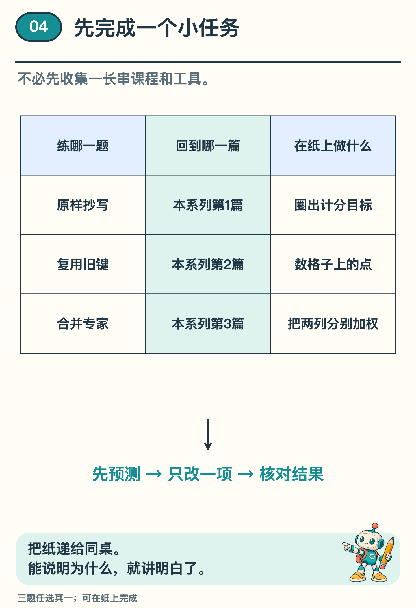
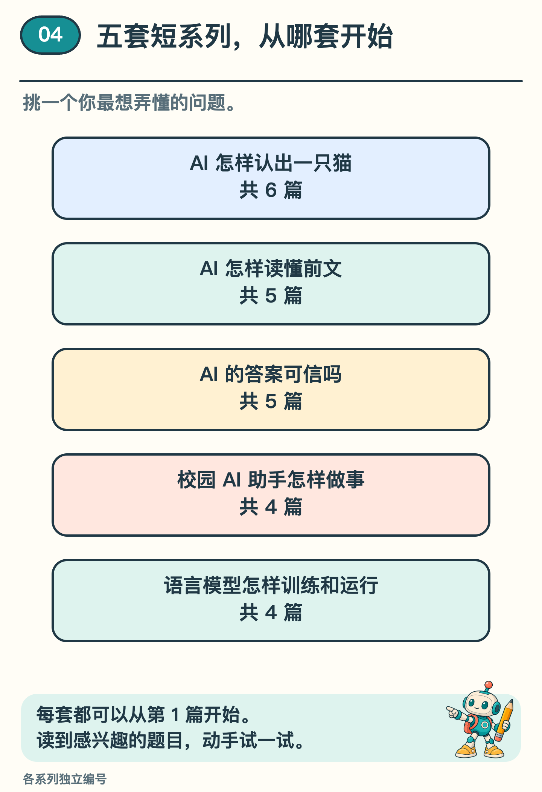

# 读懂 AI 原理之后，下一步怎样选？

抄写四个字母，途中会碰到三种不同的问题：训练时给哪一步打分？接着写时，哪一笔计算可以省？几个计算模块给出了不同的数，又该怎样合起来？挑一道你想讲给同桌听的，拿张纸试一试。

## 遮住答案，第一分该打在哪里？

把 `<abcd|abcd>` 写在纸上。竖线左边是题目，右边是要抄的答案，末尾的 `>` 表示写完了。用纸盖住竖线右边。刚读到竖线时，模型该猜哪个字母？

是第一个 `a`。先让它猜，再揭开纸核对；等它读到这个 `a`，下一猜就轮到 `b` 了。只给回答计分时，要圈出五个目标：`a b c d >`。最后一分留给“该停笔了”。这是本系列第 1 篇里的训练办法。

## 写到第四格，重复做了多少计算？

画第一格，在里面点一下，表示算出了这个位置的键（K），供后面的文字匹配。再添一格。如果每添一格都从头算，两格时要点两下，三格时点三下。到第四格，一共点了几下？

1 ＋ 2 ＋ 3 ＋ 4 ＝ 10 下。再画一排，这回算过的 K 留着，每次只点新格，一共 4 下。本系列第 2 篇里的模型只能读取当前位置和前文，参数固定，旧文字和位置也没变，所以末尾添字不会改变旧格子的 K。新格仍要跟旧格匹配，这笔账只数了算 K 的次数。

## 两个专家各出一个数，合起来是多少？

沿用本系列第 3 篇的手算例子。两个被选中的计算模块分别给出 `[2, 4]` 和 `[3, 6]`。现在让它们各占一半，先用手遮住右边那一列，只看 2 和 3。合起来的第一项会落在哪里？

2 和 3 各取一半，得到 2.5；再算另一列，4 和 6 各取一半，得到 5。最后的结果是 `[2.5, 5]`。把比重改回 0.6 和 0.4，第一项就成了 2 × 0.6 ＋ 3 × 0.4 ＝ 2.4。你能在动笔前猜到它会向 2 靠近吗？

*图 1　把预测写下来再核对。哪一步算出的结果跟你想的不一样，就从那一步往回看。*

想用程序再试一次，可以打开[训练、缓存与专家路由实验](../../Python实现/source/continuation_mechanisms/README.md)，找刚才做过的那一题。想换个问题，下面这张图可以帮你选下一套。

*图 2　认猫、读故事、查证据、找场地、练模型。每套都可以从自己的第 1 篇开始读。*
